# Rocha's Surf School

A mobile app for running a surf and skate school in Fortaleza, Brazil: the class schedule, who gets a seat, who
teaches, and every notice in between. Students, instructors and admins use the **same app** (iOS and Android). What
each person sees depends on their role and the state of their account.

| | |
| --- | --- |
| **Mobile app** (the product) | [`apps/mobile`](apps/mobile/README.md): Expo / React Native, one app for the three roles |
| **API** | [`apps/backend`](apps/backend/README.md): NestJS, PostgreSQL, Prisma |
| **Public website** | [`apps/web`](apps/web/README.md): Next.js, the legal pages the stores require, plus the designs |
| **Infrastructure** | [`infra`](infra/README.md): Terraform for the staging environment on AWS and Supabase |

---

## Contents

- [The problem](#the-problem)
- [Who uses it](#who-uses-it)
- [What the product does](#what-the-product-does)
- [Glossary](#glossary)
- [High-level architecture](#high-level-architecture)
- [How the code is organised](#how-the-code-is-organised)
- [Technologies](#technologies)
- [How it was built](#how-it-was-built)
- [Project status](#project-status)
- [Running it locally](#running-it-locally)
- [Commands](#commands)
- [Contributing](#contributing)
- [Further reading](#further-reading)

---

## The problem

A small school runs classes every day on different beaches and skate spots, each with a limited number of seats and
one or more instructors. Someone has to:

- publish the week's schedule and change it when the weather turns;
- decide who gets each seat, keep a waiting list, and apply the school's own payment and credit records;
- tell students and instructors when something changes, and remind them before class;
- apply a cancellation policy that is written in plain words ("cancel up to 2 hours before, or the class counts as
  used");
- know who is a student, who teaches and who manages the school.

Rocha's Surf School puts all of that in one app. Admins keep control of every decision (payments and credits stay
outside the app, and approving a request is how admins apply them), and the app handles the schedule, requests,
waiting lists, roles, reminders and notifications.

## Who uses it

Every account has exactly one role. New accounts start as students and wait for an admin's approval.

| Role | What they do in the app |
| --- | --- |
| **Student** | Browses every class, requests a seat (or joins the waiting list), withdraws or cancels before the deadline, sees their classes and history, gets reminders. |
| **Instructor** | Sees the classes they teach with the students and guests in them, their history and the week's occupancy. Is told when they're assigned, when a class changes, and when a student requests or cancels. |
| **Admin** | Runs the school: creates classes in batches, manages locations, approves or denies registrations and seat requests, enrols students and trial guests directly, cancels classes, writes the school and cancellation rules, sends notices, manages roles and accounts. Admins can also teach. |

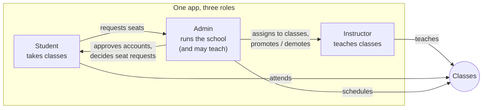

### An account's life

Which screens a person sees is decided from their account's status alone: one place in the app (`resolveFlow`) picks
the flow, and the API enforces the same rules on every request.

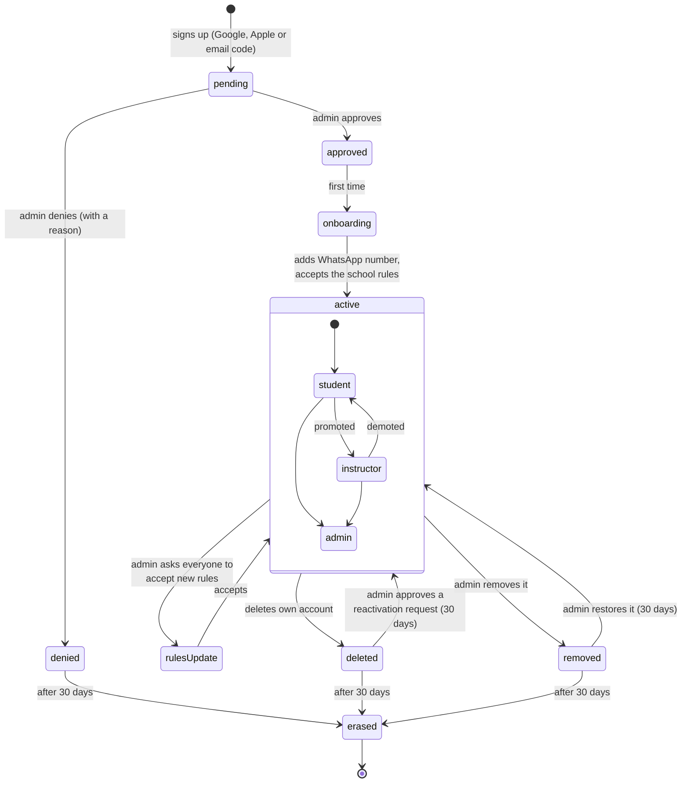

Erasing an account anonymises it: name, email, photo and WhatsApp number are removed, and class lists show
"Former student" in its place, so the school's history stays consistent.

## What the product does

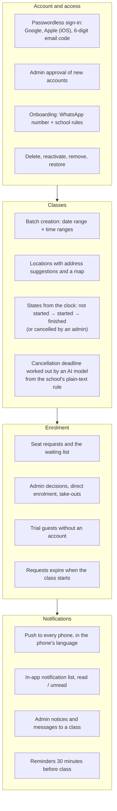

Some ground rules that shape the whole system:

- **All times are in `America/Fortaleza`**, whatever the phone's time zone. Weeks run Monday to Sunday.
- **A class's state is computed from the clock**, never stored, so it can't go stale. Only "cancelled" is stored.
- **A pending request doesn't hold a seat.** Seats taken are approved students plus guests, and admins decide who gets
  a seat that opens.
- **The app speaks Brazilian Portuguese, Spanish and English.** Text admins write (rules, notices, reasons) is shown
  as written.
- **Push is the only channel.** The sign-in code is the only email the app sends.

The full product brief is in [`.docs/user-journeys.md`](.docs/user-journeys.md) and the detailed requirements are in
[`.docs/requirements.md`](.docs/requirements.md).

## Glossary

The words below mean something precise in this codebase. The code, the specs and the app's copy all use them the same
way.

| Term | Meaning |
| --- | --- |
| **Discipline** | Surf or skate. Each discipline has its own cancellation rule. |
| **Level** | Beginner, advanced or expert. An informational label only, never a restriction. |
| **Batch** | Classes created together: every chosen day × every time range, sharing discipline, level, location, instructors, capacity and notes. All or nothing. |
| **Class state** | Not started, started, finished (computed from the clock) or cancelled (set by an admin, final). |
| **Seat taken** | An approved student or a guest. A pending request never holds a seat. |
| **Request** (enrolment) | A student's ask for a seat. Pending until an admin approves or denies it; withdrawn, expired, cancelled, taken out or ended by a cancelled class otherwise. One open request or seat per student and class. |
| **Waiting list** | A pending request while the class is full. Nobody moves up automatically: admins choose. A school-wide switch turns it off. |
| **Direct enrolment** | An admin puts an approved student straight into a class, without a request. |
| **Take-out** | An admin removes a student from a class before it starts, with an optional reason. |
| **Guest** | A person without an account, trying a class. Takes a seat, gets nothing from the app, and is shown as "Trial" to most people. Their data is erased 30 days after the class. |
| **Cancellation rule** | The plain-text policy admins write per discipline. |
| **Cancellation deadline** | The instant, per class, after which a student can no longer cancel their seat. Worked out from the rule by an AI model. |
| **School rules** | The house rules everyone accepts during onboarding. A change can ask everyone to accept the new **version**. |
| **Registration** | A new account waiting for an admin's approval. |
| **Reactivation request** | A deleted account asking to come back within 30 days. One per account. |
| **Deleted / removed / erased** | Deleted by the person, removed by an admin, erased (anonymised) 30 days after either. |
| **Notice** | An admin's broadcast to everyone, the students or the instructors. |
| **Class message** | An admin's message to the people of one class. |
| **Flow** | The group of screens an account sees for its state: `auth`, `pending`, `onboarding`, `rules-update`, `reactivation`, `offboarding-*`, `student`, `instructor`, `admin`. |
| **Test / review accounts** | Pre-approved accounts with a fixed code, for store reviewers and staging testers (`REVIEW_ACCOUNTS`). |

## High-level architecture

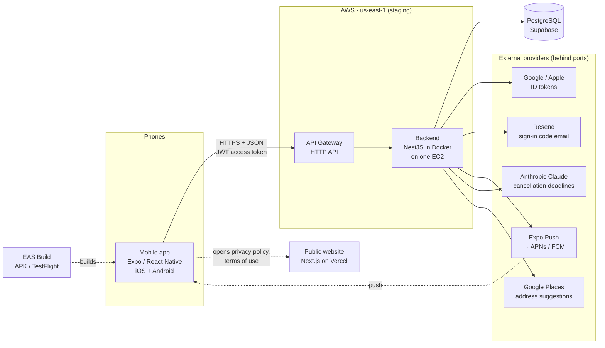

- **The mobile app is the product.** It talks to the backend over HTTPS only and never decides business rules beyond
  what the screen needs to guide the person. The backend has the final word.
- **The backend owns every rule and every side effect**: permissions, seat counting, notifications, scheduled jobs
  (expiring requests, reminders, erasing old accounts, retrying cancellation deadlines).
- **The website has no sign-in and calls no API.** It serves the privacy policy, terms of use and account-deletion
  pages the App Store and Google Play require, plus the interactive designs and test journeys.
- **Every external provider sits behind a port** (an interface in the domain), so tests fake them and a provider can
  be swapped without touching the rules.

### Ports and adapters, by business module

Business rules live in plain TypeScript modules with no framework in them. The apps adapt those rules to HTTP, the
database, the providers and the screens. Dependencies point inwards.

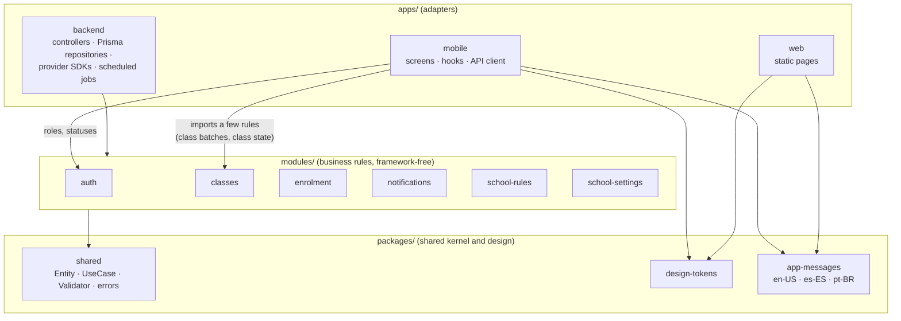

Each module follows the same shape: `model/` (entities that validate themselves), `provider/` (the ports:
repositories and providers) and `usecase/` (one class per use case). **Who may do what** is checked inside the use
cases, so permissions are unit-tested together with the rest of the rules.

### A request, end to end

What happens when a student asks for a seat in a class:

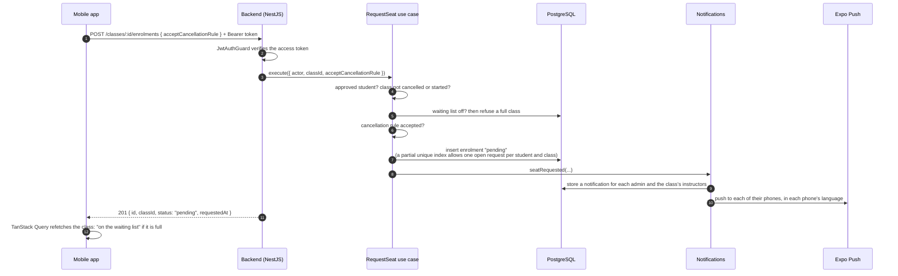

## How the code is organised

```text
rochas-surf-school/
├── apps/
│   ├── backend/          NestJS API: HTTP, Prisma, providers, scheduled jobs          → apps/backend/README.md
│   ├── mobile/           Expo app for students, instructors and admins                → apps/mobile/README.md
│   └── web/              Next.js public pages, designs and test journeys              → apps/web/README.md
├── modules/              Business modules, plain TypeScript (no Nest, Prisma or React)
│   ├── auth/             accounts, identities, sign-in codes, sessions, people, roles
│   ├── classes/          classes, locations, cancellation rules, class messages
│   ├── enrolment/        seat requests, decisions, waiting list, guests
│   ├── notifications/    stored notifications, push tokens, notices
│   ├── school-rules/     the school's rules and their version
│   └── school-settings/  WhatsApp number, waiting-list switch
├── packages/
│   ├── shared/           Entity, UseCase, Validator, domain errors, test account list
│   ├── design-tokens/    colors (light/dark), type, radii, spacing, elevation
│   ├── app-messages/     the app's copy in en-US, es-ES and pt-BR
│   ├── eslint-config/    Turbo's shared config (unused)
│   └── typescript-config/
├── infra/terraform/      staging on AWS + Supabase                                    → infra/README.md
├── .docs/                product brief, requirements, designs, staging guide
├── .specs/               the spec-driven workflow: active and finished specs, project memory
└── .github/workflows/    CI (tests), infra checks, staging deploy
```

The monorepo is a **Turborepo** with **npm workspaces**. `packages/shared`, `packages/app-messages` and every
`modules/*` compile to `dist/`, and the apps import them from there, so Turbo builds them first (`^build`).

## Technologies

| Area | Choices |
| --- | --- |
| Language | TypeScript 6 everywhere |
| Monorepo | Turborepo 2, npm workspaces, Node ≥ 24 |
| Mobile | Expo SDK 57, React Native 0.86, Expo Router, React Compiler, Reanimated 4, NativeWind (Tailwind 3), TanStack Query 5, i18next, `expo-notifications`, `react-native-maps` |
| Backend | NestJS 12 (ESM), Prisma 7, PostgreSQL 18, Passport JWT, `@nestjs/schedule`, `@nestjs/throttler` |
| Web | Next.js 16 (App Router), Tailwind 4, React 19 |
| Business modules | Plain TypeScript, Jest 30 |
| Sign-in | Google Identity, Sign in with Apple, 6-digit email codes (Resend) |
| Push | Expo Push → APNs and FCM |
| AI | Anthropic Claude, with structured outputs, to turn the plain-text cancellation rule into each class's deadline |
| Maps | Google Places API (New) on the server; Apple Maps (iOS) and Google Maps (Android) on the phone |
| Tests | Jest (modules, mobile with React Native Testing Library), Vitest (backend unit + e2e with supertest, web), Playwright (web e2e), `terraform test` |
| Infra | Terraform, AWS (EC2, API Gateway, Cloud Map, SSM, CloudWatch, ACM), Supabase, GHCR, GitHub Actions with OIDC |
| Mobile builds | EAS Build and EAS Submit (internal APK, TestFlight) |
| Website hosting | Vercel |

## How it was built

### Spec-driven development

Every change starts as a **spec** and goes through the same four steps, run with Claude Code skills that live in
[`.claude/skills/`](.claude/skills). More than 80 specs have been finished this way. Each one is kept in
[`.specs/finished/`](.specs/finished) with its decisions, tasks, evidence and review.

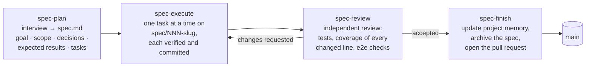

The **project memory** in [`.specs/memory/`](.specs/memory) records what the product is
([`product.md`](.specs/memory/product.md)), the technical decisions ([`technical-context.md`](.specs/memory/technical-context.md)),
the structure ([`structure.md`](.specs/memory/structure.md)) and each business module ([`modules.md`](.specs/memory/modules.md)).
Every finished spec updates it, so it always describes the code as it is.

### Design first

The screens were designed before they were built. The design files in [`.docs/designs/`](.docs/designs) (design
system, auth flow, student, instructor and admin apps) are now **generated from the website's `/designs` pages**, which
draw the same components with the same tokens and copy as the app. One set of tokens
([`packages/design-tokens`](packages/design-tokens)) and one set of messages
([`packages/app-messages`](packages/app-messages)) feed both.

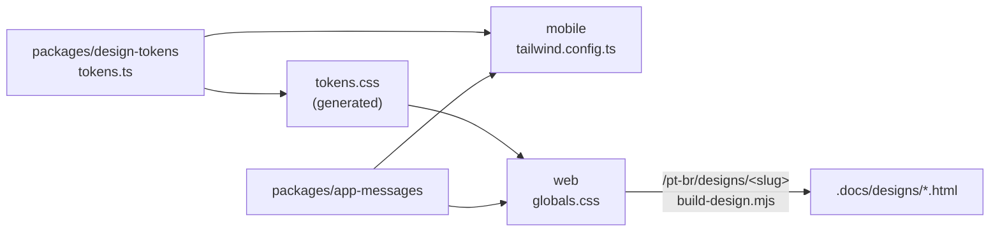

### Quality gates

- **Unit tests** for every business rule (`modules/*`, Jest) and every backend adapter (Vitest).
- **End-to-end tests** for the API against a real PostgreSQL (Vitest + supertest), with every external provider faked.
- **Component tests** for the mobile screens (Jest + React Native Testing Library).
- **Playwright** for the public website, in its three languages.
- **Coverage**: every line a spec adds or changes must be covered.
- **CI** ([`.github/workflows/ci.yml`](.github/workflows/ci.yml)) runs only the suites of the workspaces a change
  affects (`turbo ls --affected`), and a single `ci` check gates pull requests.
- **Native journeys** (sign-in with Apple, pushes, maps) are verified on the iOS simulator, the Android emulator and
  real phones through EAS builds.

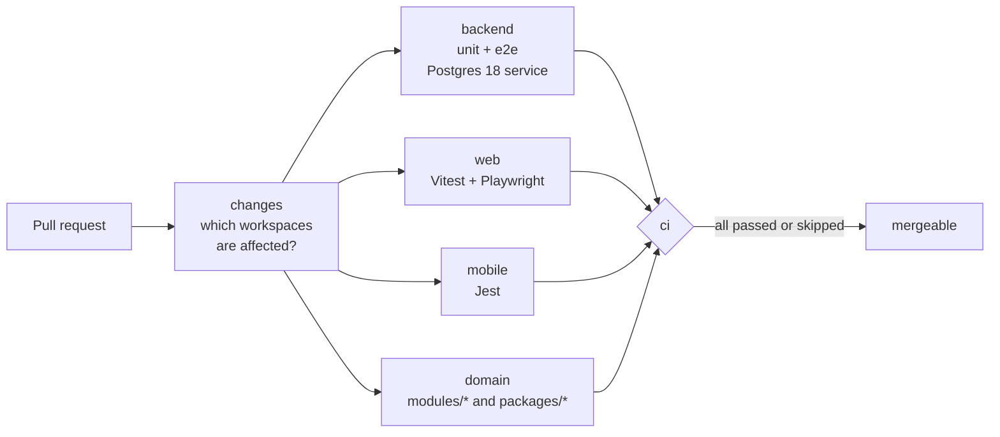

## Project status

The app is feature-complete for its first release apart from ratings and photos. It runs on a staging environment
and reaches real phones through EAS builds (an Android APK and TestFlight).

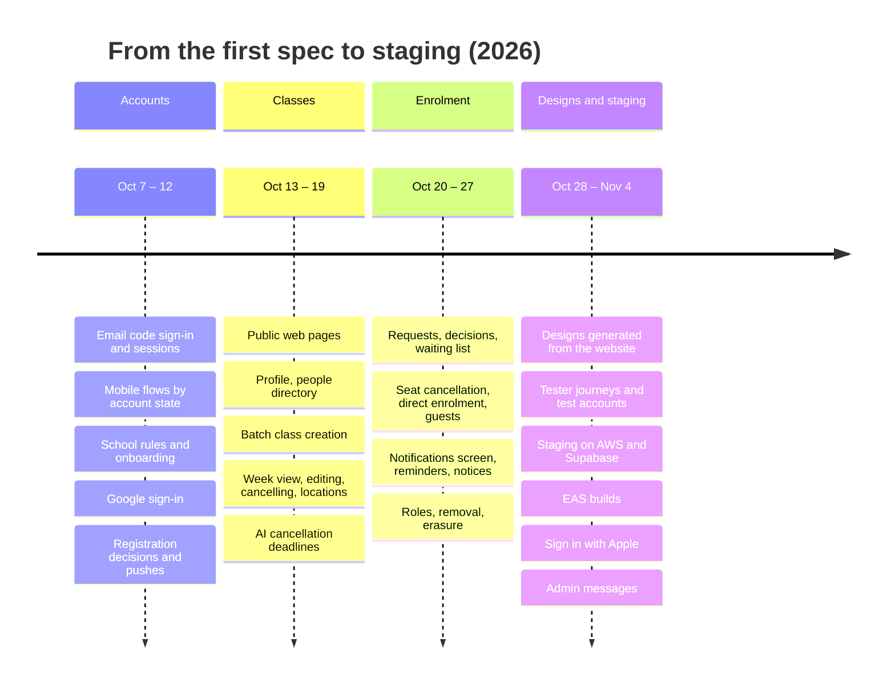

| | |
| --- | --- |
| **Built** | Sign-in (Google, Apple, email code), approval and onboarding, account deletion, reactivation, removal and erasure; classes, batches, locations, cancellation rules and AI deadlines; requests, waiting list, decisions, direct enrolment, take-outs and guests; notifications, pushes, reminders, notices and class messages; people and roles; school rules and settings; the public website, designs and tester journeys; staging and EAS builds. |
| **Planned** | [084 · Revoke Apple access when an account is deleted](.specs/changes/084-apple-token-revocation/spec.md), the last blocker before App Store submission. [081 · Staging follow-ups](.specs/changes/081-staging-follow-ups/spec.md): email DMARC, the AI spending cap, cleanup. |
| **Not started** | Class ratings and comments, class photos (and choosing the object storage for them), the production environment. |

Run `/spec-status` in Claude Code for the live board of specs.

## Running it locally

### Prerequisites

| Tool | Version | Needed for |
| --- | --- | --- |
| Node.js | ≥ 24 | everything |
| npm | ≥ 11.19 | workspaces (the repo uses npm, not pnpm or yarn) |
| Docker | any recent | the local PostgreSQL (and, optionally, the backend container) |
| Xcode + CocoaPods | a recent Xcode | the iOS app (macOS only) |
| Android Studio, JDK 17, Android SDK 36 | | the Android app |

### Quick start

The whole stack (database, API, website and app) in about five minutes:

1. **Install** every workspace from the repo root.

   ```bash
   npm install
   ```

2. **Create the env files** from the examples.

   ```bash
   cp apps/backend/.env.example apps/backend/.env
   ```

   ```bash
   cp apps/web/.env.example apps/web/.env
   ```

   ```bash
   cp apps/mobile/.env.example apps/mobile/.env
   ```

   Then fill in the two required backend secrets in `apps/backend/.env`, `JWT_SECRET` and `AUTH_CODE_PEPPER`, each
   with a value from:

   ```bash
   openssl rand -hex 32
   ```

3. **Start PostgreSQL** in Docker, apply the migrations and seed it.

   ```bash
   npm run db:start -w @rochas-surf-school/backend
   ```

   ```bash
   npm run prisma:migrate:deploy -w @rochas-surf-school/backend
   ```

   ```bash
   npm run prisma:seed -w @rochas-surf-school/backend
   ```

4. **Build the shared packages and modules** once, since the apps import them from `dist/`.

   ```bash
   npx turbo run build --filter="./packages/*" --filter="./modules/*"
   ```

5. **Start the backend and the website.** The backend answers on `http://localhost:4000` and the website on
   `http://localhost:3000`.

   ```bash
   npx turbo run dev --filter=@rochas-surf-school/backend --filter=@rochas-surf-school/web
   ```

6. **Run the app on the iOS simulator** (or see the [mobile README](apps/mobile/README.md#running-it-locally) for
   Android and physical phones).

   ```bash
   cd apps/mobile && npx expo prebuild --platform ios && npx expo run:ios
   ```

7. **Sign in.** Without `RESEND_API_KEY`, the backend **logs sign-in codes instead of emailing them**. The seed creates
   an approved admin, `admin@example.com`, and an instructor, `instructor@example.com`. Pick "email" on the sign-in
   screen, use one of those addresses, and copy the 6-digit code from the backend's output. Any other email creates a
   pending student, which the admin can approve.

Each app's README goes deeper: optional providers (Google, Apple, maps, the AI model), running in Docker, the test
suites and the native builds.

> `npm run dev` from the root starts **all three apps** at once (`turbo run dev`). It works, but the Expo dev server,
> Nest and Next then share one terminal UI. Running the app from its own folder is usually more comfortable.

## Commands

From the repo root:

| Command | What it does |
| --- | --- |
| `npm run dev` | all apps in watch mode (`turbo run dev`) |
| `npm run build` | builds every workspace, dependencies first |
| `npm run check-types` | type-checks every workspace |
| `npm run lint` | oxlint (backend, modules) and ESLint (web, mobile) |
| `npm run format` | Prettier over `*.ts`, `*.tsx` and `*.md` |
| `npx turbo run test` | every unit test suite |
| `npx turbo run <task> --filter=@rochas-surf-school/<backend\|web\|mobile>` | one task, one app |
| `npm test -w @rochas-surf-school/<module>` | one business module's tests, e.g. `@rochas-surf-school/classes` |

## Contributing

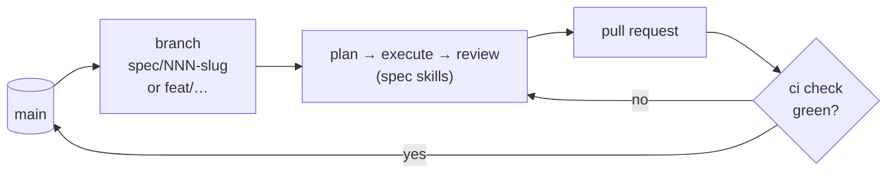

- **Never commit to `main`.** Work on a branch (`spec/NNN-slug` for a spec, `feat/…` otherwise) and merge through a
  pull request. The `ci` check is the one that must pass.
- **Plan non-trivial changes as a spec** with `/spec-plan`, then `/spec-execute`, `/spec-review` and `/spec-finish`.
  Small changes can use `/spec-plan --quick`.
- **Read the conventions first**: [`CLAUDE.md`](CLAUDE.md) (commands, layout, design-system and mobile rules) and
  [`.claude/rules/react.md`](.claude/rules/react.md) (component structure for web and mobile).
- **Business rules go in `modules/`**, not in a controller, repository, job or screen.
- **Never hard-code a color, font or radius.** Use the design tokens; if one is missing, add it to
  [`packages/design-tokens/src/tokens.ts`](packages/design-tokens/src/tokens.ts).
- **Copy goes in [`packages/app-messages`](packages/app-messages)** in all three languages; the type check fails when a
  key is missing in one of them.
- **Every line you add or change should be covered by a test.** Run the related suites before opening a pull request,
  and `npm run format` to apply Prettier.
- **Never commit secrets.** The repo is public: keys live in local `.env` files, EAS and AWS Parameter Store.

## Further reading

| Document | What's in it |
| --- | --- |
| [`apps/backend/README.md`](apps/backend/README.md) | API architecture, modules, data model, auth, jobs, providers, setup and tests |
| [`apps/mobile/README.md`](apps/mobile/README.md) | App architecture, navigation by account state, session, push, design system, setup and builds |
| [`apps/web/README.md`](apps/web/README.md) | Routes, languages, designs pipeline, configuration, setup and tests |
| [`infra/README.md`](infra/README.md) | Staging architecture on AWS and Supabase, security decisions, deploys |
| [`.docs/user-journeys.md`](.docs/user-journeys.md) | The product brief, as user journeys per role |
| [`.docs/requirements.md`](.docs/requirements.md) | Detailed requirements by area |
| [`.docs/staging.md`](.docs/staging.md) | Step-by-step runbook for the staging environment |
| [`.specs/memory/`](.specs/memory) | Project memory: product, technical context, structure, modules |
| [`CLAUDE.md`](CLAUDE.md) | Conventions and commands for working in the repo |
