# Backend: the Rocha's Surf School API

The REST API behind the [mobile app](../mobile/README.md). It owns every business rule and every side effect:
accounts and sign-in, classes and locations, seat requests and the waiting list, notifications and pushes, and the
scheduled jobs that keep it all moving (expiring requests, reminders, erasing old data, working out cancellation
deadlines).

**NestJS 12** (ESM) · **Prisma 7** · **PostgreSQL 18** · **Vitest 4** · port **4000**

← Back to the [project overview](../../README.md)

---

## Contents

- [Architecture](#architecture)
- [Folder layout](#folder-layout)
- [The life of a request](#the-life-of-a-request)
- [Business modules and endpoints](#business-modules-and-endpoints)
- [Authentication and sessions](#authentication-and-sessions)
- [Data model](#data-model)
- [Concurrency: how two admins can't take the same seat](#concurrency-how-two-admins-cant-take-the-same-seat)
- [Notifications and pushes](#notifications-and-pushes)
- [Cancellation deadlines with an AI model](#cancellation-deadlines-with-an-ai-model)
- [Scheduled jobs](#scheduled-jobs)
- [External providers](#external-providers)
- [Errors](#errors)
- [Configuration](#configuration)
- [Running it locally](#running-it-locally)
- [Tests](#tests)
- [Docker image and deployment](#docker-image-and-deployment)
- [Adding a feature](#adding-a-feature)
- [Conventions](#conventions)

---

## Architecture

The backend follows **ports and adapters**, split by business module. The rules themselves don't live in this app:
they live in the framework-free workspaces under [`modules/`](../../modules). This app is the set of **adapters** that
connects those rules to HTTP, PostgreSQL, the external providers and the clock.

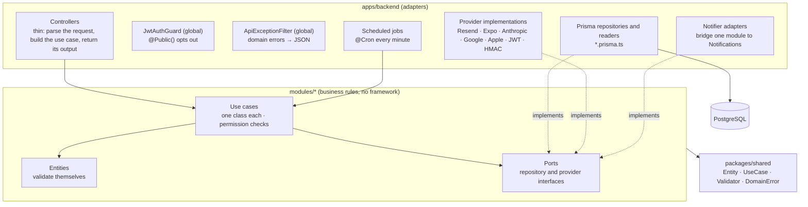

Why this shape:

- **Rules are testable without a framework.** A use case receives its dependencies through the constructor and the
  current user as input, so every permission and state rule is a plain unit test in its module.
- **Permissions live with the rules.** Use cases get the actor (id, role, status) and decide what that person may do.
  Controllers never check roles.
- **Providers are swappable.** Every external service is an interface in the domain. Tests replace it, and changing a
  provider touches one adapter file.
- **Modules don't know each other's internals.** When Classes needs to tell people something, it calls its own
  `ClassChangeNotifier` port. This app implements that port with the Notifications module, so the dependency stays
  one-way.

### What goes where

| Layer | Lives in | May depend on | Must not |
| --- | --- | --- | --- |
| Entities, ports, use cases | `modules/<module>/src/<aggregate>/` | `packages/shared`, another module's public exports | import NestJS, Prisma, React or any SDK |
| Shared kernel | `packages/shared` | nothing in the repo | hold product rules |
| Controllers, repositories, providers, jobs | `apps/backend/src/modules/<module>/` | the modules, NestJS, Prisma, SDKs | hold business rules (they belong in a use case) |
| Cross-cutting HTTP | `apps/backend/src/shared/` | NestJS | |

## Folder layout

```text
apps/backend/
├── prisma/
│   ├── schema.prisma               generator + datasource
│   ├── models/<module>.model.prisma one schema file per business module
│   ├── migrations/                 incremental, named after the module (e.g. auth-add-refresh-tokens)
│   └── seed/                       review/test accounts, sample classes, staging reset
├── src/
│   ├── main.ts                     bootstrap, CORS, PORT
│   ├── app.module.ts               config, schedule, DB, global guard and filter, feature modules
│   ├── db/                         DbModule + PrismaService (pg adapter)
│   ├── generated/prisma/           Prisma client (generated, gitignored)
│   ├── shared/                     auth guard + JWT strategy, @Public / @CurrentUser, error filter
│   └── modules/
│       ├── auth/                   sign-in, sessions, profile, people, registrations, reactivations
│       ├── classes/                classes, locations, cancellation rules, messages, AI deadlines, reminders
│       ├── enrolment/              seat requests, decisions, guests, expiry
│       ├── notifications/          notifications, push tokens, notices, Expo push, notifier adapters
│       ├── school-rules/           the school's rules and acceptances
│       ├── school-settings/        WhatsApp number, waiting-list switch
│       └── health/                 GET /health
├── test/                           e2e suites (*.e2e-spec.ts), one per area
├── Dockerfile                      multi-stage image, built from the repo root
└── docker-compose.yml              Postgres (+ the backend, optionally)
```

Inside `src/modules/<module>/` the file name says what a file is:

| Suffix | What it is |
| --- | --- |
| `*.controller.ts` | HTTP routes for one resource |
| `*.prisma.ts` | a repository or reader implemented with Prisma |
| `*.job.ts` | a scheduled job that runs a use case |
| `notifications.*-notifier.ts` | a port of another module implemented with Notifications |
| `<provider>.<port>.ts` | a provider implementation, e.g. `resend.email.ts`, `expo.push.ts`, `anthropic.deadline-describer.ts` |
| `*.spec.ts` | the unit test next to it |
| `*.integration.http` | hand-run requests for the REST Client extension (a manual aid, not a test) |

## The life of a request

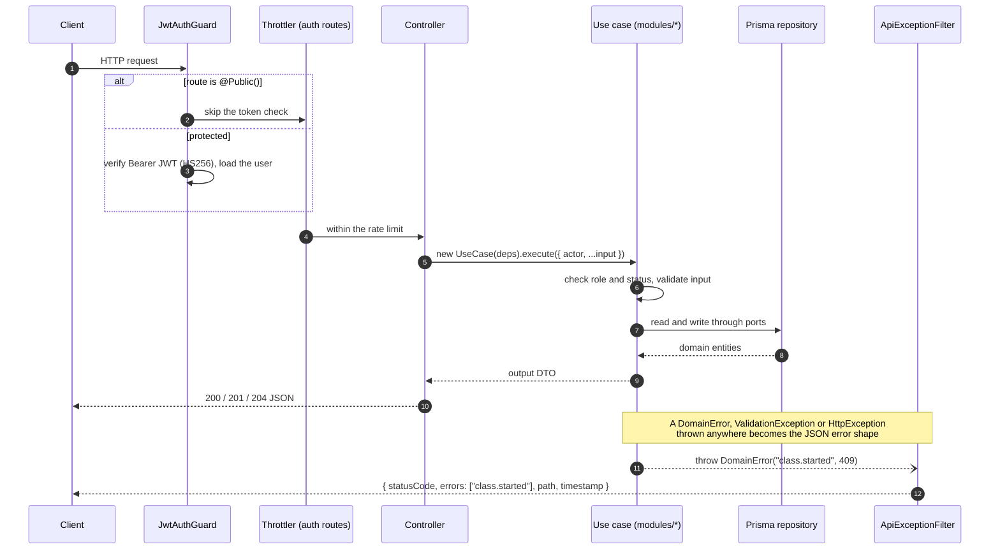

Controllers stay thin on purpose: they build the use case with the injected adapters, call `execute`, and return its
output type. Request and response types are the use case's own `In` / `Out` types.

## Business modules and endpoints

Every route is protected by the global `JwtAuthGuard` unless it says `@Public()`. Dates travel as ISO 8601 strings in
UTC. The app shows them in `America/Fortaleza`.

| Module | Workspace | Routes |
| --- | --- | --- |
| **Auth** | [`modules/auth`](../../modules/auth) | `POST /auth/email/code`, `POST /auth/email/verify`, `POST /auth/google`, `POST /auth/apple`, `POST /auth/refresh`, `POST /auth/sign-out` (all public, rate limited) · `GET/DELETE /auth/me`, `PUT /auth/me/name`, `PUT /auth/me/whatsapp`, `POST /auth/me/reactivation-request` |
| | | `GET /registrations`, `POST /registrations/:id/approve` and `/deny` |
| | | `GET /reactivation-requests`, `POST /reactivation-requests/:id/approve` and `/deny` |
| | | `GET /people`, `GET /people/removed`, `PUT /people/:id/role`, `PUT /people/:id/instructor`, `POST /people/:id/remove` and `/restore` |
| **Classes** | [`modules/classes`](../../modules/classes) | `POST /classes/batch`, `GET /classes?date=` (the week of a date), `GET /classes/:id`, `PUT /classes/:id`, `POST /classes/:id/cancel`, `DELETE /classes/:id` |
| | | `GET /classes/mine` and `/mine/history`, `GET /classes/teaching` and `/teaching/history`, `GET /classes/time-range-suggestions` |
| | | `GET /classes/:id/messages`, `POST /classes/:id/message` |
| | | `GET/POST /locations`, `PUT /locations/:id`, `POST /locations/:id/archive`, `GET /locations/address-suggestions` and `/:placeId` |
| | | `GET /cancellation-rules`, `PUT /cancellation-rules/:discipline` |
| **Enrolment** | [`modules/enrolment`](../../modules/enrolment) | `POST /classes/:id/enrolments`, `POST /enrolments/:id/withdraw`, `/cancel`, `/approve`, `/deny`, `/take-out`, `GET /enrolments/pending`, `POST /classes/:id/enrolments/direct` |
| | | `POST /classes/:id/guests`, `DELETE /guests/:id` |
| **Notifications** | [`modules/notifications`](../../modules/notifications) | `GET /notifications`, `GET /notifications/:id`, `GET /notifications/unread-count`, `POST /notifications/read-all`, `POST /notifications/:id/read` |
| | | `PUT/DELETE /notifications/push-token`, `GET /notifications/broadcast/recipients`, `POST /notifications/broadcast` |
| **School rules** | [`modules/school-rules`](../../modules/school-rules) | `GET /school-rules`, `POST /school-rules`, `PUT /school-rules/:id`, `PUT /school-rules/order`, `DELETE /school-rules/:id`, `POST /school-rules/acceptances` |
| **School settings** | [`modules/school-settings`](../../modules/school-settings) | `GET /school-settings`, `PUT /school-settings/whatsapp`, `PUT /school-settings/waiting-list` |
| **Health** | (none) | `GET /health` (public: runs `SELECT 1`, answers 200 or 503) |

Each module's business rules are described in [`.specs/memory/modules/`](../../.specs/memory/modules), and every route
has worked examples in its folder's `*.integration.http` file.

### How the modules depend on each other

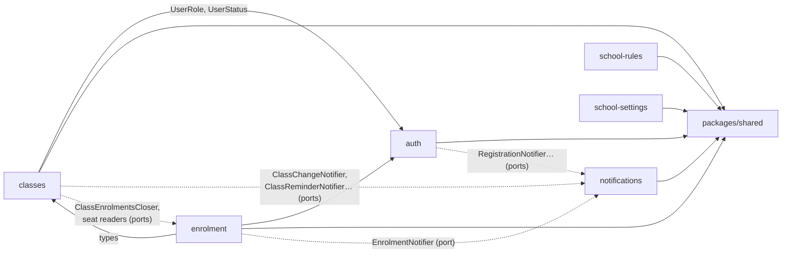

Solid arrows are package imports. Dotted arrows are ports a module declares and this app implements with another
module: Notifications depends on none of the others, and none of them imports Notifications.

## Authentication and sessions

Sign-in is passwordless. The phone gets a **Google** or **Apple** ID token natively, or the person types a **6-digit
code** sent to their email. The backend verifies it and issues its own tokens. There is **one account per email**,
whichever method is used.

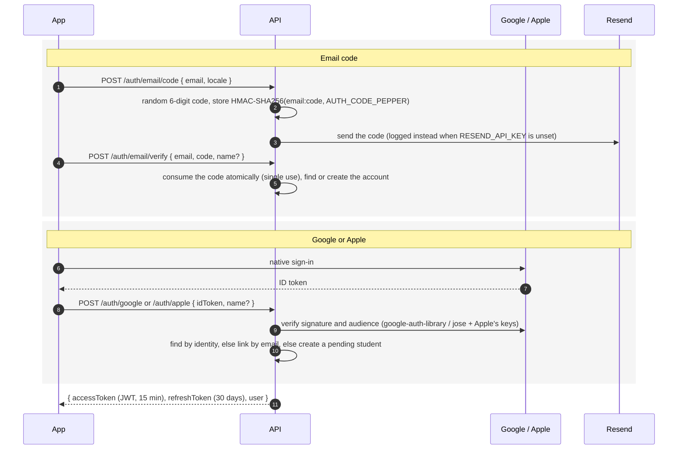

**Tokens and rotation.** The access token is a short-lived HS256 JWT. The refresh token is 32 random bytes, stored
only as a SHA-256 hash, in a **family** per sign-in. Every refresh rotates it: the old one is revoked and its successor
created in one transaction, and **reusing a revoked token revokes the whole family**, which shuts out a stolen token.

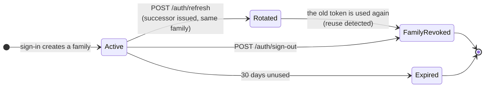

Other details:

- **Rate limits** (`@nestjs/throttler`, in memory, by client IP): 5 code requests and 10 verifications, Google/Apple
  sign-ins, refreshes and sign-outs per minute. Behind a gateway, `CLIENT_IP_HEADER` names the header that holds the
  caller's real IP.
- **Account status is checked by the use cases**, not the guard: a pending, denied, deleted or removed account can
  still read what it needs (its status, the school's WhatsApp number, its notifications) and nothing else.
- **Review accounts.** `REVIEW_ACCOUNTS` (a JSON array) gives App Store and Google Play reviewers, and testers on
  staging, one pre-approved account per role with a fixed code. `npm run test-accounts` prints a value for it.

## Data model

Each module owns its tables in `prisma/models/<module>.model.prisma`. Database names are `snake_case` (tables
lowercase and plural). Prisma models stay PascalCase, like the domain entities.

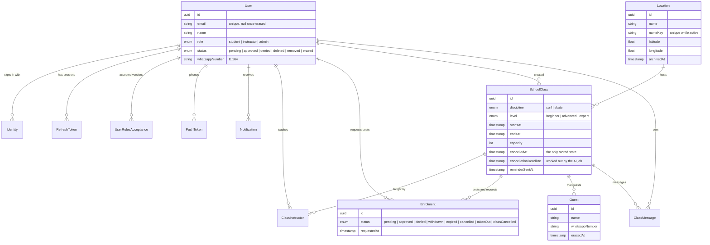

Standalone tables: `sign_in_codes`, `push_tickets`, `cancellation_rules` (one per discipline), `school_rules`,
`rules_versions` and `school_settings`.

Design decisions worth knowing:

- **A class's state is computed, never stored.** `getClassState(startsAt, endsAt, now, cancelledAt)` returns not
  started, started, finished or cancelled. Only `cancelled_at` is written (by an admin), so nothing goes stale.
- **`users.status` is the authority** for deleted and removed accounts. An erased account keeps its row, anonymised,
  so class history stays intact. Repositories never return it.
- **Accent-insensitive search** ("joao" finds "João") uses Postgres's `unaccent` through parameterised raw SQL, and
  accent-insensitive uniqueness uses a stored normalised key (`locations.name_key`).
- **A partial unique index**, written by hand in the migration, allows one open (pending or approved) enrolment per
  student and class. Prisma can't express it, so the migration is its source of truth.
- **Migrations are incremental and named after the module**: `npm run prisma:migrate:dev -w @rochas-surf-school/backend -- --name classes-add-x`.

## Concurrency: how two admins can't take the same seat

Writes that race are made safe in the database, not with application locks.

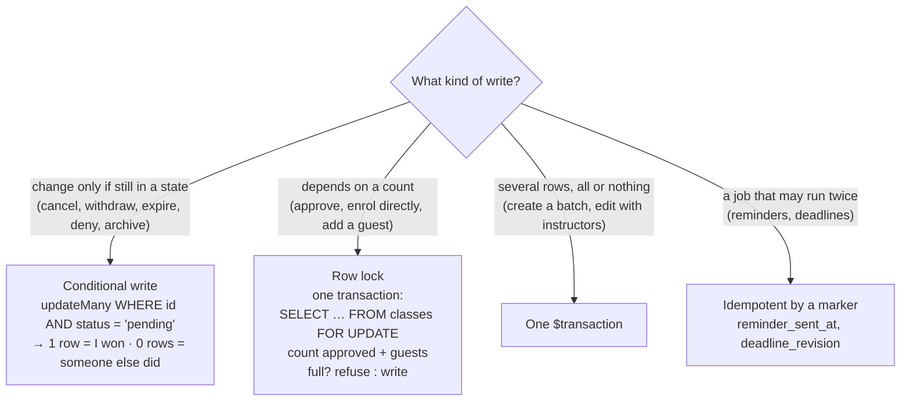

So when two admins approve the last seat at the same moment, the second transaction waits on the class row, counts
again, and answers `409 enrolment.class.full`.

## Notifications and pushes

Every notification is **stored first, then pushed** to each phone the person is signed in on, in that phone's
language. Turning pushes off on the phone stops the push, never the stored notification.

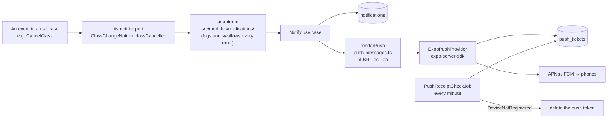

- A notification never blocks the action that caused it: if the push fails, the class is still cancelled.
- The push catalogue (`push-messages.ts`) has one entry per notification type, and a type without an entry fails the
  type check.
- Admin notices (`POST /notifications/broadcast`) go to everyone, students or instructors, and the app shows the
  number of recipients first.

## Cancellation deadlines with an AI model

Admins write each discipline's cancellation rule in plain words. Each class needs a precise instant after which a
student can no longer cancel. A job asks **Anthropic Claude** to read the rule and answer in a fixed, structured shape,
and the domain turns that into a deadline.

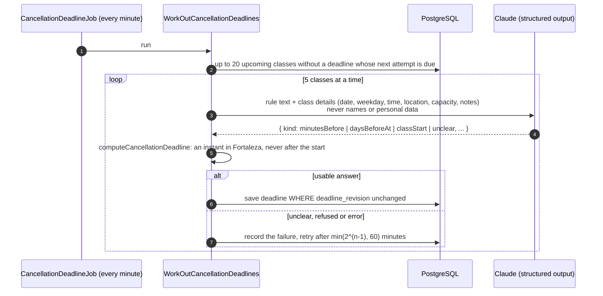

- **Editing a class or changing its rule clears the deadline** and bumps `deadline_revision`, so an answer that comes
  back for the old version is dropped.
- **While a class has no deadline**, students who try to cancel are told to contact the school, and admins see the
  class flagged.
- **No key, no calls.** Without `ANTHROPIC_API_KEY` (outside production), every class stays flagged.

## Scheduled jobs

All jobs run **every minute** with `@nestjs/schedule`, never overlap themselves (`waitForCompletion`), and are
**idempotent**: they record what they did in the database, so a restart or a late tick never repeats work.

| Job | Module | What it does |
| --- | --- | --- |
| `SignInCodeCleanupJob` | auth | Deletes expired sign-in codes |
| `AccountErasureJob` | auth | Erases denied registrations, and deleted or removed accounts, 30 days later |
| `CancellationDeadlineJob` | classes | Works out missing cancellation deadlines with the AI model, with backoff |
| `ClassReminderJob` | classes | Reminds students and instructors 30 minutes before a class (marks `reminder_sent_at`) |
| `EnrolmentExpiryJob` | enrolment | Expires requests still pending when their class starts |
| `GuestErasureJob` | enrolment | Erases a guest's name and number 30 days after their class |
| `PushReceiptCheckJob` | notifications | Reads Expo push receipts and drops tokens of uninstalled apps |

> The jobs and the in-memory rate limits assume **one backend instance**. Running several needs a lock or a queue
> first.

## External providers

Each provider is a port in a module, implemented here. Without its key **outside production** the backend still
starts and degrades gracefully, so local development needs none of them. With `NODE_ENV=production`, a missing
required key stops the backend at startup.

| Provider | Used for | Port → implementation | Without the key (dev) |
| --- | --- | --- | --- |
| **Resend** | the sign-in code email | `EmailProvider` → `resend.email.ts` | the code is **logged** to the console |
| **Google Identity** | Google sign-in | `GoogleIdTokenProvider` → `google.id-token.ts` | every Google token is refused |
| **Apple** | Sign in with Apple (iOS) | `AppleIdTokenProvider` → `apple.id-token.ts` (no secret needed) | every Apple token is refused |
| **Expo Push** | pushes to iOS and Android | `PushProvider` → `expo.push.ts` | works without a token unless enhanced security is on |
| **Anthropic** | cancellation deadlines | `CancellationDeadlineDescriber` → `anthropic.deadline-describer.ts` | classes stay without a deadline |
| **Google Places** | address suggestions for locations | `AddressSuggestionProvider` → `google-places.address-suggestions.ts` | no suggestions, the pin is placed by hand |

Tests never call any of them: unit specs mock the SDKs, and the e2e suites replace each provider with a fake through
`overrideProvider`.

## Errors

Every error leaves the API in the same shape, built by `ApiExceptionFilter`:

```json
{
  "statusCode": 409,
  "errors": ["enrolment.class.full"],
  "path": "/enrolments/0b8e…/approve",
  "timestamp": "2026-11-04T18:00:00.000Z"
}
```

- `errors` holds **message keys, not sentences**. The app translates them, so the API never deals with languages for
  errors.
- Validation errors are listed together in one `422`. A `DomainError` may add `details` for the app to use.
- Domain errors map to HTTP statuses through `packages/shared`: `ValidationException` 422, `NotFoundError` 404,
  `UnauthorizedError` 401, `ForbiddenError` 403, `ConflictError` 409, `TooManyRequestsError` 429,
  `BadGatewayError` 502, or a `DomainError` with its own status.
- Anything else is a `500` with `INTERNAL_SERVER_ERROR`, and its stack is logged.

## Configuration

Copy [`.env.example`](.env.example) to `.env`. `@nestjs/config` loads it globally.

| Variable | Required | What it is |
| --- | --- | --- |
| `PORT` | no (4000) | HTTP port |
| `DATABASE_HOST`, `DATABASE_PORT`, `DATABASE_USER`, `DATABASE_PASSWORD`, `DATABASE_NAME` | yes, or `DATABASE_URL` | PostgreSQL connection. Use `127.0.0.1`, not `localhost`: on macOS the name lookup sometimes hangs for seconds |
| `DATABASE_URL` | alternative | full connection string; wins over the `DATABASE_*` values (staging uses it) |
| `JWT_SECRET` | **yes** | signs access tokens. Generate with `openssl rand -hex 32` |
| `JWT_EXPIRES_IN` | no (`15m`) | access token lifetime |
| `AUTH_CODE_PEPPER` | **yes** | key of the HMAC that protects stored sign-in codes. Generate with `openssl rand -hex 32` |
| `REFRESH_TOKEN_EXPIRES_IN_DAYS` | no (30) | refresh token lifetime, sliding |
| `RESEND_API_KEY`, `EMAIL_FROM` | production | send the sign-in code email |
| `REVIEW_ACCOUNTS` | no | JSON array of pre-approved accounts with fixed codes (store reviewers, staging testers) |
| `CLIENT_IP_HEADER` | no | header with the real client IP behind a gateway (`x-client-ip` on staging) |
| `GOOGLE_WEB_CLIENT_ID` | for Google sign-in | audience of Google ID tokens (not secret, already in the example) |
| `APPLE_CLIENT_ID` | for Apple sign-in | the app's bundle id, `com.rochassurfschool.app` (not secret) |
| `EXPO_ACCESS_TOKEN` | no | only with Expo's enhanced push security |
| `ANTHROPIC_API_KEY` | production | the AI model for cancellation deadlines |
| `GOOGLE_MAPS_API_KEY` | production | Google Places address suggestions |

## Running it locally

### Prerequisites

- Node.js ≥ 24 and npm ≥ 11.19
- Docker (for PostgreSQL)
- Dependencies installed from the **repo root**: `npm install`

### Option A: backend on your machine, PostgreSQL in Docker (recommended)

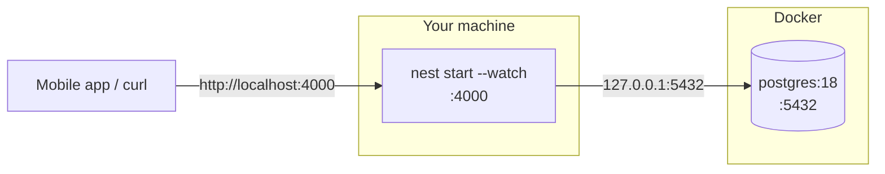

1. Create your env file from the example, from the repo root.

   ```bash
   cp apps/backend/.env.example apps/backend/.env
   ```

2. Fill in `JWT_SECRET` and `AUTH_CODE_PEPPER` in `apps/backend/.env`, each with a value from:

   ```bash
   openssl rand -hex 32
   ```

3. Start PostgreSQL. It reads its credentials from the same `.env`.

   ```bash
   npm run db:start -w @rochas-surf-school/backend
   ```

4. Apply the migrations.

   ```bash
   npm run prisma:migrate:deploy -w @rochas-surf-school/backend
   ```

5. Seed it: an approved admin (`admin@example.com`), an instructor (`instructor@example.com`), a location and a few
   classes around today, plus any accounts in `REVIEW_ACCOUNTS`. Running it again moves the same classes; it never
   runs in production.

   ```bash
   npm run prisma:seed -w @rochas-surf-school/backend
   ```

6. Build the business modules and shared packages it imports from `dist/`.

   ```bash
   npx turbo run build --filter=@rochas-surf-school/backend^...
   ```

7. Start the API in watch mode.

   ```bash
   npm run dev -w @rochas-surf-school/backend
   ```

8. Check that it answers.

   ```bash
   curl -s http://localhost:4000/health
   ```

### Signing in without the app

Without `RESEND_API_KEY`, codes are printed in the backend's output:
`Sign-in code for admin@example.com: 123456 (RESEND_API_KEY unset, not sent)`.

```bash
curl -s -X POST http://localhost:4000/auth/email/code -H 'Content-Type: application/json' -d '{"email":"admin@example.com","locale":"en"}'
```

```bash
curl -s -X POST http://localhost:4000/auth/email/verify -H 'Content-Type: application/json' -d '{"email":"admin@example.com","code":"123456"}'
```

The answer holds an `accessToken` to send as `Authorization: Bearer <token>`. The `*.integration.http` files in each
module folder have a ready request for every route.

To get a fixed set of test accounts instead (12 sets of admin, instructor and student), print a `REVIEW_ACCOUNTS`
value, paste its first line into `.env` and run the seed again:

```bash
npm run test-accounts -w @rochas-surf-school/backend
```

### Option B: everything in Docker

Builds the production image and runs it next to PostgreSQL. The compose file points the backend at the `postgres`
service by itself. Migrations aren't run by the container, so apply them from your machine first (step 4 above).

```bash
cd apps/backend && docker compose up --build
```

### Useful database commands

| Command (with `-w @rochas-surf-school/backend`) | What it does |
| --- | --- |
| `npm run db:start` / `db:stop` / `db:logs` | the Docker PostgreSQL |
| `npm run prisma:migrate:dev -- --name <module>-<change>` | create a migration from the schema |
| `npm run prisma:migrate:deploy` | apply pending migrations |
| `npm run prisma:seed` | run the seed tasks |
| `npm run prisma:studio` | browse the data in Prisma Studio |
| `npm run prisma:generate` | regenerate the client (also runs before build, tests and type checks) |

## Tests

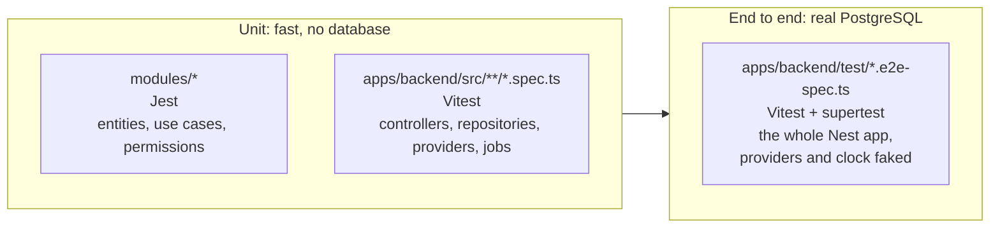

| Command | What it runs |
| --- | --- |
| `npm test -w @rochas-surf-school/backend` | backend unit tests |
| `npx vitest run src/modules/classes/classes.controller.spec.ts` (from `apps/backend`) | one file. Add `-t "<name>"` for one test |
| `npm run test:cov -w @rochas-surf-school/backend` | unit tests with coverage |
| `npm run test:e2e -w @rochas-surf-school/backend` | e2e suites against the database in `.env`, with migrations applied |
| `npm test -w @rochas-surf-school/<module>` | a business module's Jest suite, e.g. `@rochas-surf-school/enrolment` |

About the e2e suites:

- They need PostgreSQL running with the migrations applied (steps 3 and 4 above).
- **Every external provider is faked** (Expo, Anthropic, Google, Apple, Places), so they need no keys.
- Suites that depend on time **fix the clock**, some far in the future (2037), so they never touch real data in a
  shared development database. Each one deletes what it created.
- Files run one at a time, because some share the single `rules_versions` row.

In CI, the `backend` job starts a PostgreSQL 18 service, applies the migrations, and runs the unit and e2e suites
whenever a change affects the backend or a module it uses.

## Docker image and deployment

The [`Dockerfile`](Dockerfile) builds from the **repo root**, so the workspace packages the backend depends on compile
first.

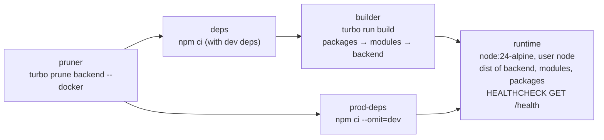

```bash
docker build -f apps/backend/Dockerfile -t rochas-backend .
```

Staging runs this image on ARM (`--platform linux/arm64` when building on x86). The
[deploy workflow](../../.github/workflows/deploy-staging.yml) publishes it to GHCR, applies the migrations, seeds the
test accounts and restarts the server. See the [infrastructure README](../../infra/README.md) for how it runs.

## Adding a feature

A new piece of behaviour starts in the domain and works outwards. Each step has a project skill in
[`.claude/skills/`](../../.claude/skills) that scaffolds it the same way as the rest of the code.

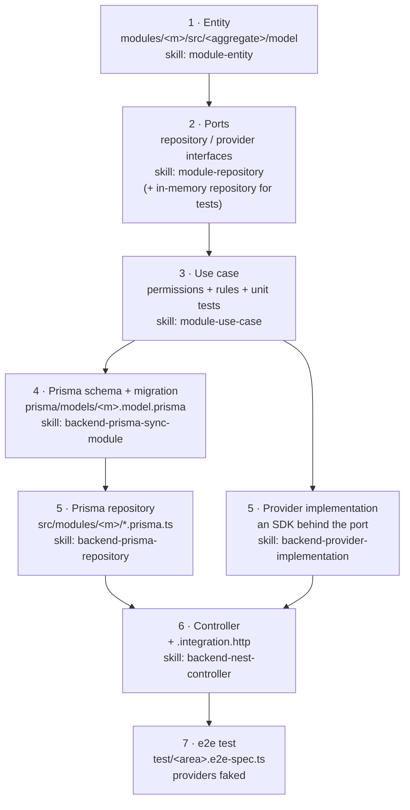

- A brand-new business area starts with the `config-new-module` skill, which creates `modules/<name>` and the matching
  Nest module.
- If the feature needs to tell people something, declare a notifier port in the module and implement it in
  `src/modules/notifications/`, with a catalogue entry in `push-messages.ts` for each language.
- Something that must happen at a given time is a scheduled job that runs a use case, idempotent by something it writes.
- A new environment variable goes in [`.env.example`](.env.example), and in Parameter Store for staging.

## Conventions

- **ESM**: relative imports end in `.js`.
- **Lint** with `oxlint --type-aware` (`npm run lint -w @rochas-surf-school/backend`).
- **A rule found in a controller, repository or job belongs in a use case.**
- Shared HTTP plumbing in `src/shared/` is generated by the `backend-nest-config` skill. Fix its templates and rerun
  the skill instead of editing it by hand.
- Project skills scaffold the rest consistently: `config-new-module`, `module-entity`, `module-use-case`,
  `module-repository`, `backend-prisma-sync-module`, `backend-prisma-repository`, `backend-nest-controller`,
  `backend-provider-implementation` (in [`.claude/skills/`](../../.claude/skills)).
