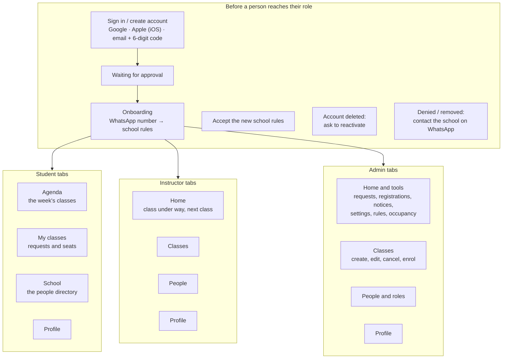
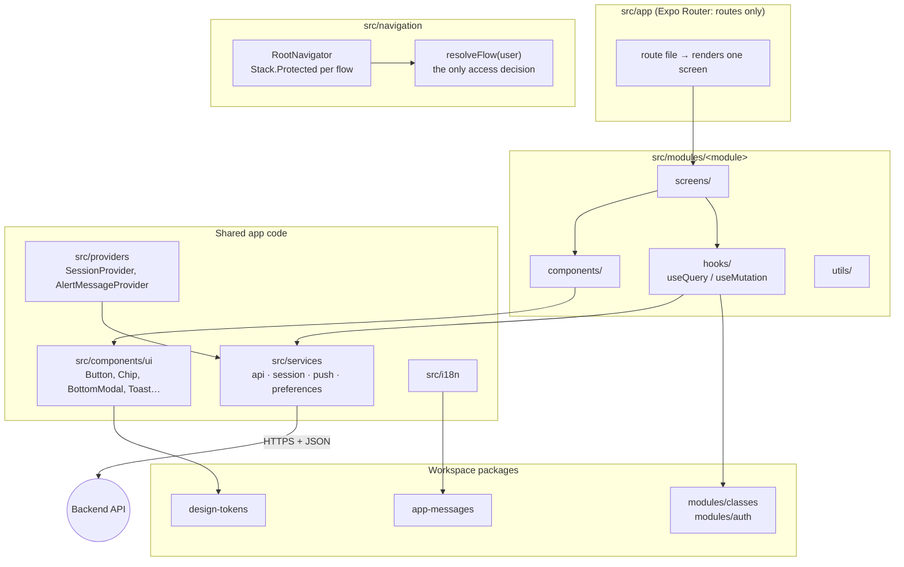
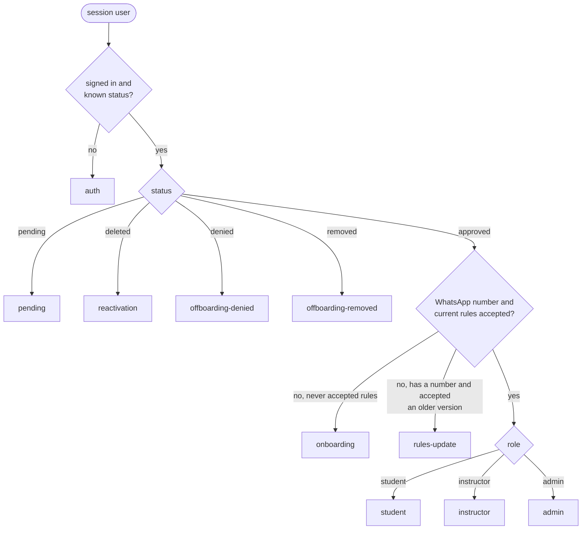
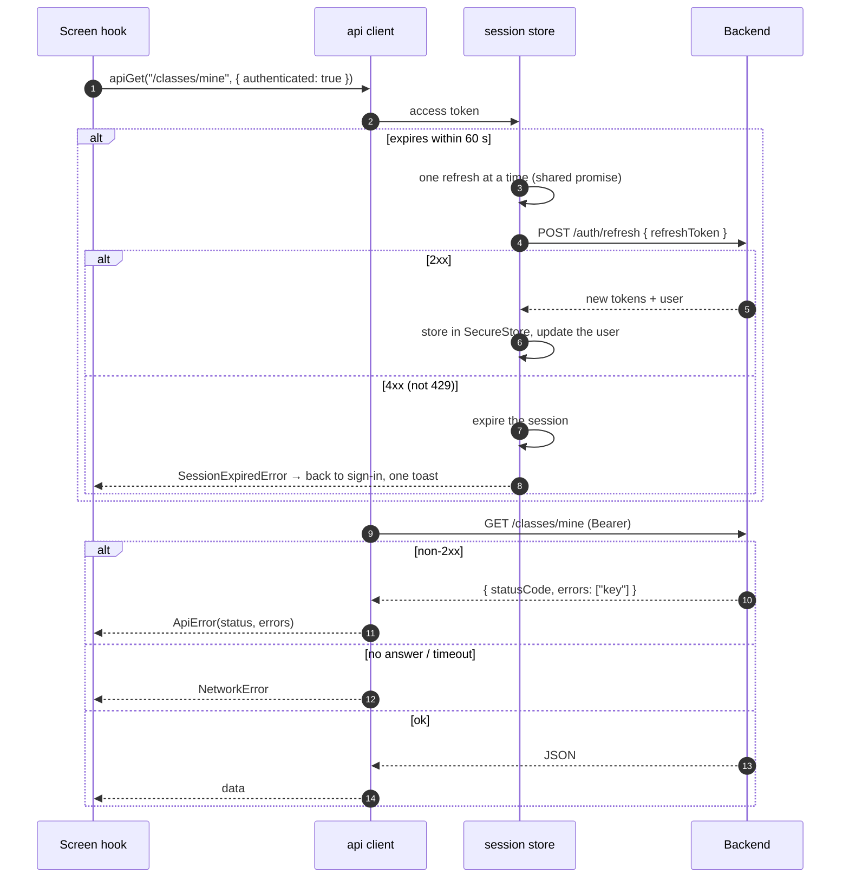
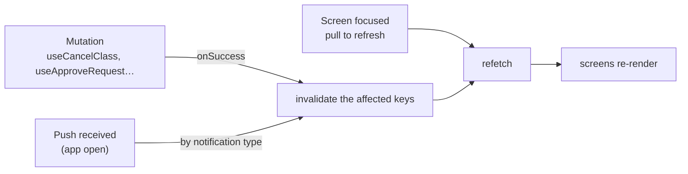
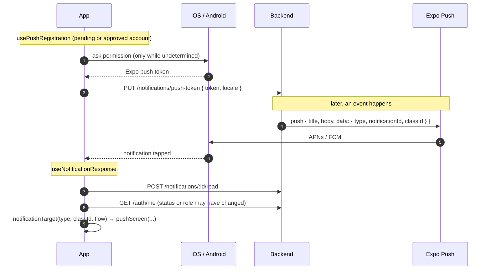
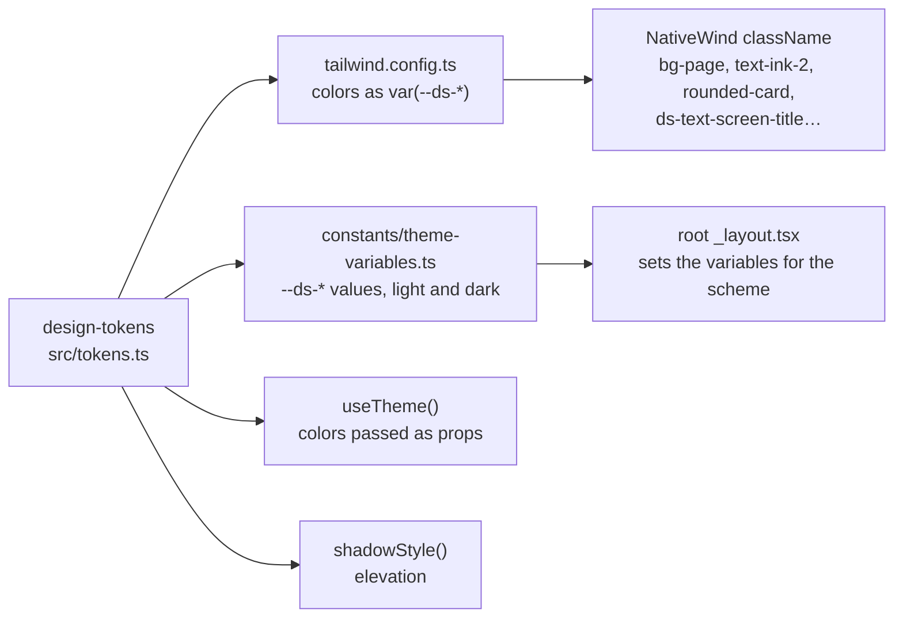
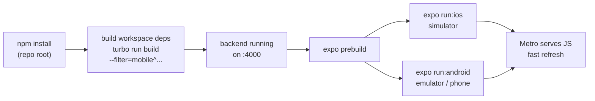
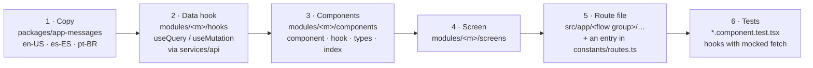
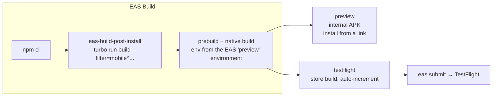

# Mobile: the Rocha's Surf School app

The product itself. One app on **iOS and Android** for students, instructors and admins: what each person sees
depends on their role and the state of their account. It talks to the [backend](../backend/README.md) over HTTPS and
leaves every decision to it.

**Expo SDK 57** · **React Native 0.86** · **Expo Router** · **React Compiler** · **NativeWind** · **TanStack Query** ·
**i18next**

← Back to the [project overview](../../README.md)

---

## Contents

- [What's in the app](#whats-in-the-app)
- [Architecture](#architecture)
- [Folder layout](#folder-layout)
- [Navigation: one flow per account state](#navigation-one-flow-per-account-state)
- [Session and the API client](#session-and-the-api-client)
- [Server data with TanStack Query](#server-data-with-tanstack-query)
- [Push notifications](#push-notifications)
- [Design system and styling](#design-system-and-styling)
- [Languages, theme and device preferences](#languages-theme-and-device-preferences)
- [Sharing rules with the backend](#sharing-rules-with-the-backend)
- [Component conventions](#component-conventions)
- [Configuration](#configuration)
- [Running it locally](#running-it-locally)
- [Tests](#tests)
- [Adding a screen](#adding-a-screen)
- [Builds for real phones (EAS)](#builds-for-real-phones-eas)

---

## What's in the app



Every role also has: class details (with seats, people, messages and the location on a map), the class history,
notifications, the school rules, profile editing, theme and language.

## Architecture



Principles:

- **Routes are thin.** A file under `src/app/` renders a screen from `src/modules/<module>/screens/` and nothing else.
- **Access is decided in one place.** `resolveFlow` picks the flow from the session's user. Screens never check roles
  or statuses to decide whether they may show.
- **The backend decides.** The app validates enough to guide the person (a field, a count) and shows the backend's
  answer. Message keys from API errors are translated on the phone.
- **Server state lives in TanStack Query**, device state (theme, language, push switch) in secure storage, and the
  session in its own store.

## Folder layout

```text
apps/mobile/
├── app.json / app.config.ts     Expo config. app.config.ts adds the maps plugin and Firebase file from env
├── eas.json                     EAS build profiles (preview APK, TestFlight)
├── plugins/                     config plugins (native changes go here, never in ios/ or android/)
├── tailwind.config.ts           NativeWind theme built from @rochas-surf-school/design-tokens
├── jest.setup.ts                mocks for every native piece
└── src/
    ├── app/                     routes, grouped by flow
    │   ├── _layout.tsx          fonts, splash, theme variables, providers, RootNavigator
    │   ├── index.tsx            redirects to the resolved flow's entry route
    │   ├── (public)/auth/       sign-in, email, create account, confirm code, provider name
    │   ├── (pending)/           waiting for approval
    │   ├── (onboarding)/        WhatsApp number, school rules
    │   ├── (rules-update)/      accept new rules
    │   ├── (reactivation)/      account deleted
    │   ├── (offboarding)/       denied, removed
    │   └── (private)/
    │       ├── student/         (tabs)/(agenda), my-classes, school, profile + stack screens
    │       ├── instructor/      (tabs)/(home), classes, people, profile + stack screens
    │       └── admin/           (tabs)/(home), classes, people, profile + tools
    ├── modules/<module>/        screens/, components/, hooks/, utils/ per feature
    ├── components/              cross-module components (calendars, phone field, role tabs…)
    │   └── ui/                  design-system primitives, same names and props as web
    ├── navigation/              resolveFlow, RootNavigator, SplashGate, stack header options
    ├── providers/               session, alert messages (toasts)
    ├── services/                api client, session store and refresh, push, preferences, Google/Apple sign-in
    ├── i18n/                    i18next setup, backend locale mapping
    ├── constants/               routes, theme, theme variables, fonts
    ├── hooks/                   useTheme, useSchoolSettings, keyboard helpers
    └── utils/                   dates, phone numbers, countries
```

## Navigation: one flow per account state

Each account state has exactly one flow, and **`resolveFlow`** ([`src/navigation/resolve-flow.ts`](src/navigation/resolve-flow.ts))
is the single place that picks it. `RootNavigator` wraps each flow's route group in `Stack.Protected`, so a group is
reachable only while its flow is the resolved one. When the session changes (signing in, an approval push, a role
change), the guards close the old group and `src/app/index.tsx` sends the person to the new flow's entry route.



To add a screen to a flow: put the screen in `src/modules/<module>/screens/` and a route file in that flow's folder
under `src/app/`. Never decide access anywhere else.

The Stack header draws the back button (shared options in `src/navigation/stack-header/`). Screens set their title and
`headerRight` with `<Stack.Screen options>`, and header actions use `HeaderButton`. Tab bars are the system's native
tabs (`NativeTabs`), drawn by the shared `RoleTabs`.

Screens open with **`pushScreen`** ([`src/navigation/push-screen.ts`](src/navigation/push-screen.ts)), a singular push:
if the same route with the same params is already in the stack, it's brought to the top instead of being pushed
again, so a second tap during the slide-in opens nothing new. ESLint rejects a direct `router.push`.

## Session and the API client

The session (four token fields and the account) is kept in **`expo-secure-store`** and restored before the splash
screen hides. Every request goes through one small `fetch` client in [`src/services/api/`](src/services/api):
`apiGet`, `apiPost`, `apiPut`, `apiDelete`. Callers never see tokens; they pass `{ authenticated: true }`.



Why it is built this way:

- **One refresh at a time.** The backend rotates refresh tokens and revokes the whole family when one is reused, so two
  parallel refreshes would sign the person out. The store shares one in-flight refresh.
- **Only a verdict ends the session.** A `429` or a network failure keeps the session; only a `4xx` refusal from
  `/auth/refresh` expires it.
- **The splash screen waits** for the fonts and the restored session (`SplashGate`), so no frame shows the wrong
  flow.

## Server data with TanStack Query

Every screen fetches, caches, retries and invalidates the same way: one `QueryClient` in the root layout, mutations
without retry, and query keys per resource (`["classes", "week", monday]`, `["classes", "detail", id]`, `["notifications", "list"]`,
`["enrolments", "pending"]`…). Paginated lists are `useInfiniteQuery` per filter combination.



When a push arrives with the app open, `useNotificationReceived` invalidates what it concerns (a cancelled class
refreshes `["classes"]`, a new request refreshes `["enrolments", "pending"]`…), so open screens update without the
person pulling to refresh.

## Push notifications



- Turning pushes off in the profile **deletes this phone's token** on the backend. Notifications still appear on the
  notifications screen.
- A tap opens the screen that fits **the account's current flow**: a `class.cancelled` push opens the class for a
  student, instructor or admin; a `registration.pending` push opens the registrations tool for an admin; anything else
  goes to `/` and lets `resolveFlow` decide.
- Pushes need a physical device and a build that knows the EAS project, so they work on EAS builds, not on the
  simulator.

## Design system and styling

Every color, font, radius, spacing and elevation comes from
[`@rochas-surf-school/design-tokens`](../../packages/design-tokens). Nothing is hard-coded, so light and dark themes
both work.



- **Style with NativeWind `className`**, using the same utility names as the web app. `inlineRem` is 16, as on the
  web, so a class is the same size on both platforms.
- Use `style` only for what a class can't express: runtime values (safe-area insets, measurements), Reanimated
  styles, elevation (`shadowStyle()`), and third-party props that take style objects or colors (`useTheme()`).
- **Buttons are `TouchableOpacity`** with `activeOpacity`. List rows use `Pressable`. A link inside a sentence is a
  `TextButton`.
- Usage rules (one primary action per screen, grape only for highlights, numbers in Barlow Condensed, 44 px touch
  targets) are in section 08 of [`.docs/designs/design-system.html`](../../.docs/designs/design-system.html).
- After changing `tailwind.config.ts` or the tokens, restart Metro with `--clear`.

## Languages, theme and device preferences

- **Three languages**: Brazilian Portuguese, Spanish and English, with i18next. The messages live in
  [`@rochas-surf-school/app-messages`](../../packages/app-messages), typed so a missing key fails the type check. Until
  the person chooses, the app follows the phone, falling back to Brazilian Portuguese.
- **Theme**: system, light or dark, applied with `Appearance.setColorScheme` before the first render.
- **These belong to the phone, not the account**: theme, language and the push switch are stored in secure storage
  (`prefs.theme`, `prefs.locale`, `prefs.pushEnabled`) and survive signing out.
- **Dates** use `date-fns` with `@date-fns/tz`, always shown in `America/Fortaleza`.
- **WhatsApp numbers** use `libphonenumber-js`, with Brazil (+55) preselected and masked as you type.

## Sharing rules with the backend

The app imports a few pure functions from the business modules, so the screen and the API can never disagree:

| From | What | Why |
| --- | --- | --- |
| `@rochas-surf-school/classes` | `listBatchClasses`, `listBatchDates`, time-range checks, limits, `getClassState` | "Create 12 classes" counts exactly what the backend creates, and a class is "started" at the same instant everywhere |
| `@rochas-surf-school/auth` | `USER_ROLES`, `USER_STATUSES` | `resolveFlow` only accepts known values |
| `@rochas-surf-school/shared` | the `Validator` rules | forms validate like the backend |

Metro reads these from each workspace's built `dist/`, which is why they have to be built before the app starts.

## Component conventions

Components follow [`.claude/rules/react.md`](../../.claude/rules/react.md), shared with the web app:

```text
language-sheet/
├── index.ts                      exports the component only
├── language-sheet.component.tsx  JSX, calls its own hook
├── language-sheet.hook.ts        state and logic (only when needed)
└── language-sheet.types.ts       props and every other type
```

- Components are named function declarations; hooks and callbacks are arrow functions.
- `useCallback`, `useMemo` and `React.memo` only for a demonstrated problem (the React Compiler handles the rest).
- Design-system components have the same names and props on mobile and web (`src/components/ui/{button,chip}`).
- Before writing or reviewing code here, load the `vercel-react-native-skills` and `vercel-react-best-practices` skills.

## Configuration

Copy [`.env.example`](.env.example) to `.env`. `EXPO_PUBLIC_*` values are compiled into the JavaScript bundle. The
others are read by `app.config.ts` at prebuild.

| Variable | Required | What it is |
| --- | --- | --- |
| `EXPO_PUBLIC_API_URL` | yes | the backend. `http://localhost:4000` works on the **iOS simulator**; use `http://10.0.2.2:4000` on the **Android emulator** and `http://<your LAN IP>:4000` on a **physical phone** |
| `EXPO_PUBLIC_WEB_URL` | no | the website, for the privacy policy and terms of use rows (hidden without it) |
| `EXPO_PUBLIC_GOOGLE_WEB_CLIENT_ID` | for Google sign-in | the web OAuth client; it is the audience the backend checks (not secret, already in the example) |
| `EXPO_PUBLIC_GOOGLE_IOS_CLIENT_ID` | for Google sign-in on iOS | the iOS OAuth client (not secret) |
| `GOOGLE_MAPS_ANDROID_API_KEY` | for maps on Android | Maps SDK for Android. iOS uses Apple Maps and needs no key |
| `GOOGLE_SERVICES_JSON` | for pushes on Android | path to Firebase's `google-services.json`. Empty locally; an EAS file variable in builds |

## Running it locally

The app uses native modules (Google sign-in, maps, Apple sign-in), so it runs as a **development build** made with
`expo run`, not in Expo Go. `ios/` and `android/` are generated by `npx expo prebuild` and gitignored: never edit them
by hand. Native changes go through config plugins.



### Prerequisites

- Node.js ≥ 24, npm ≥ 11.19, dependencies installed from the **repo root** with `npm install`
- **iOS**: macOS with Xcode and CocoaPods
- **Android**: Android Studio, JDK 17 and Android SDK 36
- The **backend running** locally. See the [backend README](../backend/README.md#running-it-locally)

### Steps

1. Create your env file and point `EXPO_PUBLIC_API_URL` at your backend (see the table above for the emulator and
   physical phones).

   ```bash
   cp apps/mobile/.env.example apps/mobile/.env
   ```

2. Build the workspace packages the app imports from `dist/` (design tokens, messages, shared, the business modules).

   ```bash
   npx turbo run build --filter=@rochas-surf-school/mobile^...
   ```

3. Generate the native project and run it on the **iOS simulator**.

   ```bash
   cd apps/mobile && npx expo prebuild --platform ios && npx expo run:ios
   ```

   Or on the **Android emulator** (or a phone connected over USB):

   ```bash
   cd apps/mobile && npx expo prebuild --platform android && npx expo run:android
   ```

4. Next time, when nothing native changed, just start Metro and open the installed app.

   ```bash
   npm run start -w @rochas-surf-school/mobile
   ```

### Signing in locally

- **Email code** works with no setup: with `RESEND_API_KEY` unset, the backend prints the code in its output. The
  backend's seed creates an approved admin (`admin@example.com`) and instructor (`instructor@example.com`).
- **Google sign-in** works with the client ids already in `.env.example` (debug keystore and simulator).
- **Sign in with Apple** is iOS only and unreliable on the simulator. Its full round trip is checked on a TestFlight
  build.
- Any new email becomes a **pending student**: sign in as the admin on another device or simulator to approve it.

### Troubleshooting

| Symptom | Fix |
| --- | --- |
| `Unable to resolve module @rochas-surf-school/...` | build the workspace packages (step 2) |
| Styles or tokens didn't change | restart Metro with `npx expo start --clear` |
| Network request failed on Android | `EXPO_PUBLIC_API_URL` must be `http://10.0.2.2:4000` on the emulator, or your LAN IP on a phone |
| The iOS app crashes at launch on iOS 27 | keep `plugins/with-ios-scene-lifecycle.js`: Expo SDK 57's template doesn't adopt the UIScene life cycle |
| A blank map on Android | set `GOOGLE_MAPS_ANDROID_API_KEY` and prebuild again |
| No pushes | pushes need a physical device and an EAS build |

## Tests

**Jest** (`jest-expo`) with **React Native Testing Library 14**. Tests sit next to the component as
`<name>.component.test.tsx` and run in English (US).

| Command | What it runs |
| --- | --- |
| `npm test -w @rochas-surf-school/mobile` | every test |
| `npx jest src/modules/auth/components/auth` (from `apps/mobile`) | one folder or file. Add `-t "<name>"` for one test |
| `npm run check-types -w @rochas-surf-school/mobile` | TypeScript |
| `npm run lint -w @rochas-surf-school/mobile` | ESLint (`expo lint`) |

- `jest.setup.ts` mocks every native piece: secure storage (an in-memory map), notifications, localization,
  Reanimated, safe area, the bottom sheet, maps, location, Google and Apple sign-in, the date-time picker.
- In RNTL 14 `render` and `userEvent` are async, so `await` them.
- Tests that need a signed-in app seed the real session store with `hydrateSession`, and mock `fetch` per test.
- There is no automated end-to-end suite for the app. User journeys are checked by driving the app on the iOS
  simulator and the Android emulator, and on real phones through EAS builds.

## Adding a screen



1. **Copy first.** Add the keys to the three files in `packages/app-messages/src/` and rebuild that package
   (`npm run build -w @rochas-surf-school/app-messages`); the type check names any missing key.
2. **Fetch through a hook** in the module's `hooks/`, with a query key that the mutations and the push handler can
   invalidate (`["classes", …]`, `["enrolments", …]`).
3. **Build components from `src/components/ui`** and the tokens. No raw colors, sizes or fonts.
4. **Add the route file** in the folder of the flow that should see it. The flow guards do the rest: never check the
   role or status inside the screen.
5. **Set the title and header actions** with `<Stack.Screen options>` and `HeaderButton`, and open the screen with
   `pushScreen` (a direct `router.push` fails lint).
6. **If a push should open it**, add the case to `notificationTarget` in `src/modules/notifications/utils/`.

## Builds for real phones (EAS)

Builds that reach real phones are made on **EAS**. The repo is public and holds no store credential: the keystore,
certificates, APNs and FCM keys live on EAS.



| Profile | Distribution | Use |
| --- | --- | --- |
| `preview` | internal, Android APK | install on any Android phone from a link |
| `testflight` | store | iOS build sent to TestFlight with `eas submit` |

Both profiles use the EAS `preview` environment, which points the app at the
[staging API](../../infra/README.md). App identity: `com.rochassurfschool.app` on both platforms.
