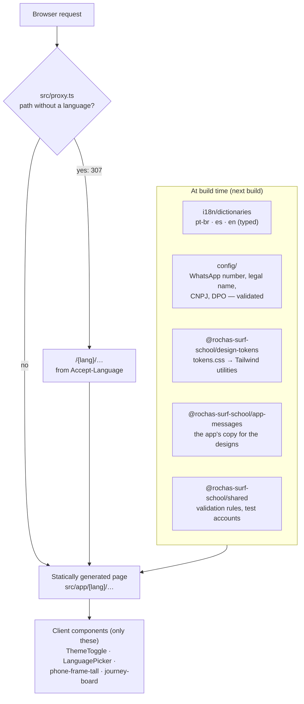
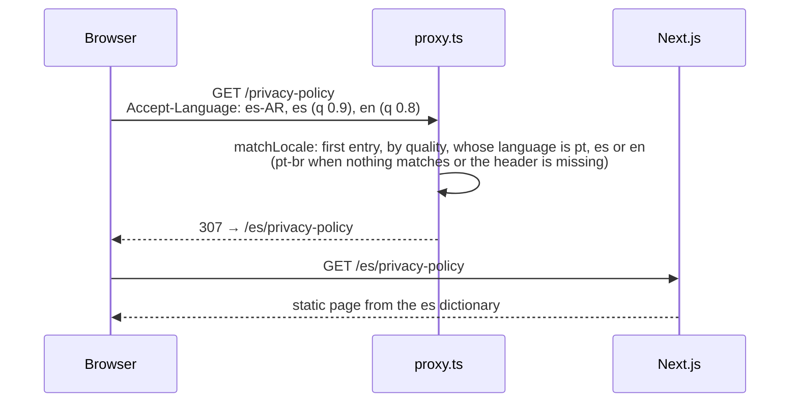
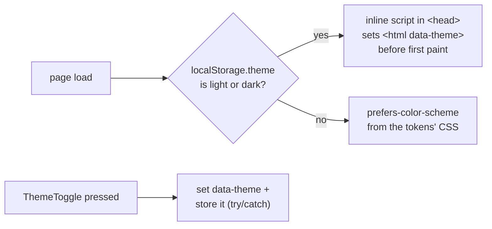
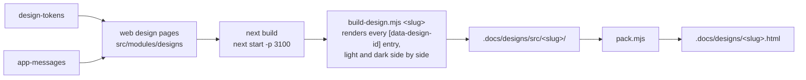

# Web: the Rocha's Surf School website

The product's only web surface. It has three jobs:

1. **The public pages the App Store and Google Play require**: privacy policy, terms of use and how to delete an
   account, in Brazilian Portuguese, Spanish and English.
2. **The designs**: every screen of the [mobile app](../mobile/README.md), drawn with the same tokens and copy, which
   also generate the design files in [`.docs/designs/`](../../.docs/designs).
3. **The user journeys for testers**: checklists of what to try on staging, linked to the designs, plus the test
   accounts.

No sign-in, no private area and **no API calls**. Every page is statically generated.

**Next.js 16** (App Router, `src/`) · **React 19** · **Tailwind 4** · **Vitest** · **Playwright** · port **3000**

← Back to the [project overview](../../README.md)

---

## Contents

- [What it serves](#what-it-serves)
- [Architecture](#architecture)
- [Folder layout](#folder-layout)
- [Languages](#languages)
- [Theme](#theme)
- [The designs pipeline](#the-designs-pipeline)
- [User journeys and test accounts](#user-journeys-and-test-accounts)
- [Configuration](#configuration)
- [Running it locally](#running-it-locally)
- [Tests](#tests)
- [Common changes](#common-changes)
- [Deployment](#deployment)

---

## What it serves

`lang` is `pt-br`, `es` or `en`. Any other value answers 404. Slugs are in English in every language.

| URL | Page | Who it's for |
| --- | --- | --- |
| `/{lang}` | Home, with links to the three pages | everyone |
| `/{lang}/privacy-policy` | Privacy policy (controller, data protection contact, providers, legal bases, retention) | the stores, users |
| `/{lang}/terms-of-use` | Terms of use | the stores, users |
| `/{lang}/account-deletion` | How to delete an account, with the school's WhatsApp number | the stores, users |
| `/{lang}/designs` | Index of the design pages | the team |
| `/{lang}/designs/{design-system,auth-flow,student-app,instructor-app,admin-app}` | Every screen and component, light and dark | the team |
| `/{lang}/user-journeys` | Index of the test journeys (not indexed by search engines) | testers |
| `/{lang}/user-journeys/{auth,student,instructor,admin}` | One journey board per flow | testers |
| `/{lang}/user-journeys/test-accounts` | The staging test accounts and their code | testers |

`/`, `/privacy-policy`, `/terms-of-use`, `/account-deletion`, `/designs/…` and `/user-journeys/…` without a language
redirect to the visitor's language (see [Languages](#languages)).

The mobile app opens the privacy policy and the terms of use in its in-app browser, from `EXPO_PUBLIC_WEB_URL`.

## Architecture



Decisions:

- **Server components by default.** Only the theme toggle, the language picker, the tall phone frame of the designs
  and the journey board run on the client.
- **Configuration is checked at build time.** A missing or invalid school variable makes `next build` fail and name it,
  so a broken legal page can't be deployed.
- **Copy is typed.** Each dictionary `satisfies Dictionary`, so a missing or extra key fails `check-types`, and copy
  changes are text-only.
- **It needs a Node runtime** (`next start` or a platform that runs Next), because of the language redirect. Static
  export isn't used.

## Folder layout

```text
apps/web/
├── src/
│   ├── proxy.ts                    language redirect (Next 16's replacement for middleware)
│   ├── app/
│   │   ├── globals.css             imports tokens.css and maps it to Tailwind utilities
│   │   └── [lang]/
│   │       ├── layout.tsx          <html lang>, fonts, the pre-paint theme script
│   │       ├── (site)/             home, privacy policy, terms of use, account deletion (narrow shell)
│   │       ├── designs/            design pages (wide shell)
│   │       └── user-journeys/      journey boards and test accounts (wide shell, noindex)
│   ├── components/                 site shell, header, language picker, theme toggle, content cards
│   │   └── ui/{button,chip}/       same names and props as the mobile app
│   ├── config/                     school-whatsapp.ts, school-legal.ts (build-time env, validated)
│   ├── i18n/                       locales, matchLocale, typed dictionaries
│   └── modules/
│       ├── designs/                mocks of the app's components and screens, ids, mock data, pages
│       └── user-journeys/          flows and rows, translations, journey board, progress storage
├── e2e/                            Playwright suites
├── playwright.config.ts            builds and serves the site on port 3100
└── vitest.config.ts
```

## Languages



- The header's **language picker** is a `<details>` pill with plain links to the same page in each language, so it
  works without JavaScript.
- `generateStaticParams` builds every page in the three languages, with `dynamicParams = false`, so an unknown language
  is a 404.
- `generateMetadata` gives every page a translated title and description.

## Theme

The site follows the OS color scheme until the visitor presses the header's toggle.



The sun and moon icons swap with CSS only, because the server can't know the theme. There is no "system" option in
the UI.

## The designs pipeline

The design pages draw every screen of the mobile app as **presentational web mocks** with the mobile components'
names and props, the same tokens, and the app's real copy (read from `@rochas-surf-school/app-messages` with `appT`).
Each frame has a stable id (`DS-…`, `AF-…`, `ST-…`, `IN-…`, `AD-…`), so `/{lang}/designs/<page>#<id>` opens at that
screen.

The `.html` design files in [`.docs/designs/`](../../.docs/designs) are **generated from these pages**, so the web
components are the source of truth and the files are never edited by hand.



Regenerate one design file (from the repo root, after building the web app and serving it on port 3100):

```bash
npm run build -w @rochas-surf-school/web && cd apps/web && npx next start -p 3100
```

```bash
node .docs/designs/scripts/build-design.mjs student-app
```

Check that every `.html` matches its sources:

```bash
node .docs/designs/scripts/pack.mjs --check
```

## User journeys and test accounts

The journey pages turn the product's user journeys into **checklists for testers**. Each row (`AU-01`, `ST-12`…) says
what to prepare, the steps and the expected result, quotes the app's labels in the page's language, and links to the
design frame it covers.

- A tester marks each row approved or denied and adds notes. Progress is saved in `localStorage` per flow, shared by
  the three languages, and "Copy results" puts a summary on the clipboard.
- A missing translation or design id is a type error.
- `/{lang}/user-journeys/test-accounts` lists the 12 staging test sets from `@rochas-surf-school/shared` and their sign-in
  code. These accounts must never exist on a production server.
- Nothing outside the user journeys links to them, and they are `noindex`.

## Configuration

All variables are **server-only and read at build time**. `next build` fails, naming the variable, when a required one
is missing or invalid. Copy [`.env.example`](.env.example) to `.env`.

| Variable | Required | What it is |
| --- | --- | --- |
| `SCHOOL_WHATSAPP_NUMBER` | yes | The school's WhatsApp number in E.164 (e.g. `+5585999999999`), linked as `https://wa.me/<digits>` |
| `SCHOOL_LEGAL_NAME` | yes | The school's legal name, shown as the controller in the privacy policy |
| `SCHOOL_CNPJ` | no | The CNPJ (14 digits, `.` `/` `-` allowed, check digits validated), shown as `00.000.000/0000-00`. Unset or empty: no CNPJ line |
| `DPO_NAME` | yes | Name of the data protection contact (encarregado) |
| `DPO_EMAIL` | yes | Email of the encarregado, shown as a `mailto:` link |

`SCHOOL_WHATSAPP_NUMBER` is a build-time copy of the school's setting in the app, so the site is rebuilt when the number
changes. Turbo hashes these variables, so a change also invalidates the cached build.

## Running it locally

### Prerequisites

- Node.js ≥ 24 and npm ≥ 11.19
- Dependencies installed from the **repo root**: `npm install`

### Steps

1. Create your env file. The example's values are placeholders that pass validation.

   ```bash
   cp apps/web/.env.example apps/web/.env
   ```

2. Build the packages it imports (design tokens, app messages, shared).

   ```bash
   npx turbo run build --filter=@rochas-surf-school/web^...
   ```

3. Start the dev server on `http://localhost:3000`. Opening `/` redirects to your browser's language.

   ```bash
   npm run dev -w @rochas-surf-school/web
   ```

A production build, served the way it runs in production:

```bash
npm run build -w @rochas-surf-school/web
```

```bash
npm run start -w @rochas-surf-school/web
```

## Tests

| Command | What it runs |
| --- | --- |
| `npm test -w @rochas-surf-school/web` | **Vitest** + React Testing Library + jsdom: components, config validation, utils (`src/**/*.test.{ts,tsx}`) |
| `npm run test:e2e -w @rochas-surf-school/web` | **Playwright** (Chromium): builds and serves the site on port 3100 and checks every page in the three languages, the language redirect, the theme toggle, the language picker, the designs and the user journeys |
| `npm run check-types -w @rochas-surf-school/web` | `next typegen` + TypeScript, including the dictionaries' keys |
| `npm run lint -w @rochas-surf-school/web` | ESLint |

Before the first Playwright run, install Chromium:

```bash
cd apps/web && npx playwright install chromium
```

The Playwright suite needs `apps/web/.env`, because it runs `next build`. Outside CI it reuses a server already running
on port 3100.

## Common changes

| Change | Where | Watch out for |
| --- | --- | --- |
| Edit the text of a public page | `src/i18n/dictionaries/{pt-br,es,en}.ts` | change all three; the `Dictionary` type keeps their keys in step |
| Add a public page | a folder under `src/app/[lang]/(site)/`, its copy in the dictionaries, its path in `src/proxy.ts`'s `matcher` | without the matcher entry, the path without a language isn't redirected |
| Change the privacy policy because of a new provider, retention or kind of data | the policy sections of the three dictionaries | the policy names every provider chosen; the stores check it |
| Draw a new app screen in the designs | `src/modules/designs/` (mock, id in `data/*-ids.ts`, section component) | then regenerate the `.html` with `build-design.mjs` |
| Add a tester journey row | `src/modules/user-journeys/data/user-journey-flows.ts` and its three `i18n/` files | ids are sequential per flow; the row must link to existing design ids |
| Change the school's WhatsApp number or legal details | the env variables, then rebuild | the site only reads them at build time |

## Deployment

The site is deployed on **Vercel**, which runs the Next.js build with the variables above. The mobile app's
`EXPO_PUBLIC_WEB_URL` points at its production URL.
