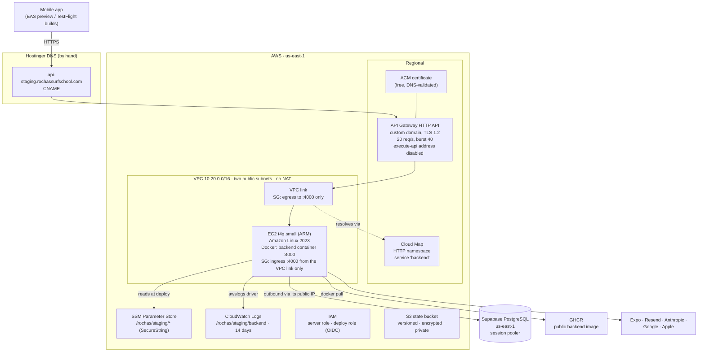
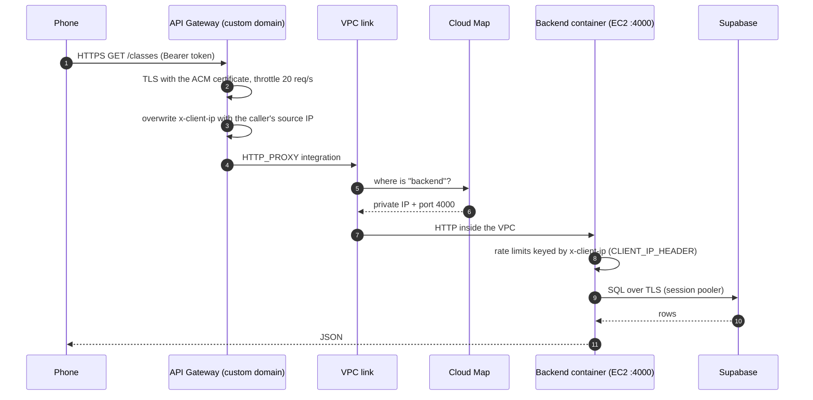
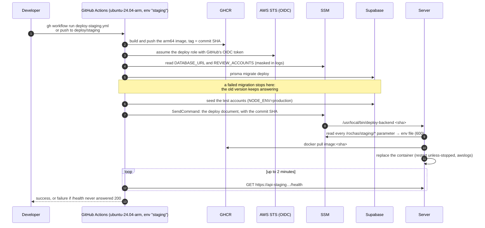
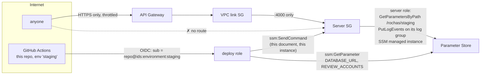
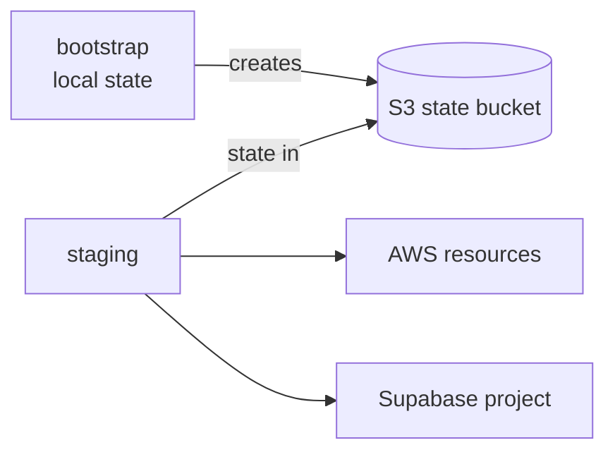
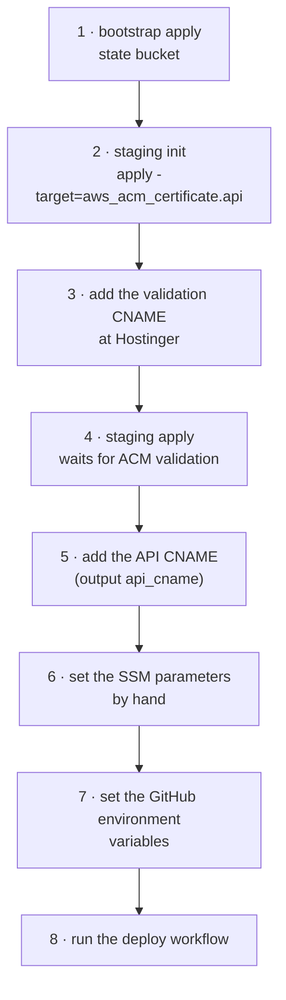
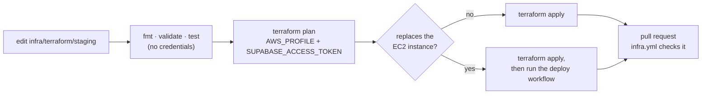

# Infrastructure

Terraform for the **staging environment** of the [backend](../apps/backend/README.md): a small, cheap testing
environment at `https://api-staging.rochassurfschool.com`, on AWS with a Supabase database. The phone builds made on
EAS point at it, so testers use the real app against a real server.

**Production isn't decided yet.** Where it runs and how its secrets are managed belong to the spec that deploys it.
The website stays on Vercel, and the mobile app ships through the App Store and Google Play.

← Back to the [project overview](../README.md) · Step-by-step runbook: [`.docs/staging.md`](../.docs/staging.md)

---

## Contents

- [Architecture](#architecture)
- [How a request reaches the backend](#how-a-request-reaches-the-backend)
- [How a deploy works](#how-a-deploy-works)
- [Decisions and their reasons](#decisions-and-their-reasons)
- [Security model](#security-model)
- [The Terraform stacks](#the-terraform-stacks)
- [Setting it up](#setting-it-up)
- [Validating and testing locally](#validating-and-testing-locally)
- [Operating it](#operating-it)
- [Changing the infrastructure](#changing-the-infrastructure)
- [Known limits](#known-limits)

---

## Architecture



| Piece | What it is | Why |
| --- | --- | --- |
| Compute | One `t4g.small` EC2 (ARM), one Docker container | Enough for one Nest process with the school's load, and eligible for the free plan |
| Entry point | API Gateway HTTP API → VPC link → Cloud Map → port 4000 | HTTPS and rate limiting without a load balancer, and no inbound path to the server from the internet |
| Database | Supabase PostgreSQL, same region, session pooler | Managed Postgres without running RDS; the server has no IPv6, so the direct connection isn't an option |
| Secrets | SSM Parameter Store, one `SecureString` per variable | The repo is public; one place to read and rotate them |
| Logs | CloudWatch through Docker's `awslogs` driver, 14 days | Readable without opening a session on the server |
| Image | `ghcr.io/steniowagner/rochas-surf-school-backend`, tagged by commit | Free, public, and holds no secrets |
| State | S3 bucket with native lock file, created by a bootstrap stack | The state holds the database password |

The whole stack costs **about $18 a month** in `us-east-1` (about $26 in São Paulo).

## How a request reaches the backend



The gateway **overwrites** `x-client-ip`, and the server is reachable only through the gateway, so a caller can't fake
the IP the rate limits use.

## How a deploy works

Deploys are **manual**: run the [`deploy-staging.yml`](../.github/workflows/deploy-staging.yml) workflow from `main`,
or push any commit to the `deploy/staging` branch.



Why migrations run on the runner, not the server: `prisma` and `tsx` are dev dependencies and aren't in the runtime
image. Running them first means a broken migration never takes the running version down.

## Decisions and their reasons

These come from [spec 079](../.specs/finished/20261030203027-079-staging-backend-infra/spec.md), where each one was
discussed.

| Decision | Reason | Rejected alternative |
| --- | --- | --- |
| Everything in `us-east-1`, Supabase included | ~$18/month instead of ~$26, so the AWS credits last longer. 25 ms more latency doesn't matter for testing | São Paulo |
| One `t4g.small` running one container | Enough for the load, free-plan eligible. Keeps the **one-instance** assumption of the scheduled jobs and in-memory rate limits | ECS / several instances, which need a lock or queue first |
| API Gateway → VPC link → Cloud Map, no load balancer | HTTPS and throttling for the price of requests | An ALB, which costs more than the rest of the stack together; a direct HTTP integration, which leaves the server open in plain HTTP |
| Public subnets, public IP for **outbound only**, no NAT | A public IP costs ~$3.65/month, a NAT gateway over $30. The security group already blocks every inbound path | NAT gateway in private subnets |
| No SSH: port 22 closed, no key pair, SSM only | Nothing to leak and nothing to scan | A bastion or an open port 22 |
| Secrets in SSM Parameter Store, set by hand | The repo is public. Terraform creates the permissions, never the values | Secrets in Terraform variables or state; Secrets Manager (paid per secret) |
| Terraform applied from the developer's machine; CI only validates | The state holds the database password, CI has no AWS credentials, and one developer gains nothing from a remote apply | Apply from CI |
| Manual deploys with OIDC, no long-lived AWS keys | The role trusts only this repo's `staging` environment, by GitHub's immutable subject. It can run one document on one instance and read two parameters | Access keys stored in GitHub secrets |
| Native ARM runner | Builds the arm64 image without slow emulation | QEMU on an x86 runner |
| DNS stays at Hostinger, CNAMEs added by hand | Leaves the domain's other records untouched, and the API URL is built into the phone apps, so it must stay stable | Moving the zone to Route 53 |
| `GET /health` runs only `SELECT 1` and is public | API Gateway, Docker and the deploy all need one anonymous check that reveals nothing | |
| Logs to CloudWatch, 14 days | Readable without a session on the server, within the cost target | |

## Security model



- **No inbound access** except port 4000 from the VPC link's security group. The server's IMDSv2 is required (hop
  limit 1) and its root volume is encrypted.
- **The deploy role can't run arbitrary commands.** It may send one SSM document, which only accepts a 40-character
  hex commit SHA and runs `deploy-backend` with it.
- **Least-privilege server role**: read its own parameter path, write its own log group, and the SSM managed-instance
  policy for sessions.
- **The image is public and holds no secrets.** The server builds its env file from Parameter Store at every deploy,
  with mode `600`.
- **The database connection is encrypted** (`sslmode=require&uselibpqcompat=true`), though the certificate isn't
  verified: the `pg` driver refuses Supabase's chain otherwise.
- **The test accounts on staging are public by design** (the website lists them for testers), so they must never reach
  a production server.

## The Terraform stacks

```text
infra/terraform/
├── bootstrap/                  the S3 bucket for the staging state (its own state stays local)
│   ├── main.tf                 bucket: versioned, AES256, public access blocked, prevent_destroy
│   ├── variables.tf · outputs.tf · providers.tf · terraform.tf
└── staging/
    ├── terraform.tf            providers (aws ~> 6.71, random ~> 3.9, supabase ~> 1.11), S3 backend with use_lockfile
    ├── providers.tf            default tags; Supabase reads SUPABASE_ACCESS_TOKEN
    ├── locals.tf               name, port, parameter path, log group, subnet CIDRs
    ├── variables.tf            region, AZs, instance type, image, domain, OIDC subject, Supabase org
    ├── network.tf              VPC, IGW, two public subnets, route table, the two security groups
    ├── api.tf                  Cloud Map, VPC link, HTTP API, integration, stage throttling, ACM, custom domain
    ├── server.tf               log group, server role and instance profile, EC2 instance
    ├── templates/user-data.sh.tftpl   installs Docker and the deploy-backend script
    ├── supabase.tf             random database password, Supabase project
    ├── deploy.tf               GitHub OIDC provider, deploy role, SSM deploy document
    ├── outputs.tf              CNAMEs, instance id, deploy role ARN, Supabase ref, DB password (sensitive)
    └── tests/network.tftest.hcl  terraform test with mocked providers
```



Requirements: **Terraform ≥ 1.14**, providers `hashicorp/aws` 6, `hashicorp/random` 3 and `supabase/supabase` 1. The
provider lock files are committed; `*.tfstate` and `.terraform/` are ignored.

## Setting it up

You only need this to create or change the staging environment. To run the backend on your machine, see the
[backend README](../apps/backend/README.md#running-it-locally). The full runbook, with every command, is
[`.docs/staging.md`](../.docs/staging.md).

### Prerequisites

- An AWS account and a CLI profile for it (`export AWS_PROFILE=rochas-surf-school`)
- A Supabase access token that can create projects in the organisation, exported as `SUPABASE_ACCESS_TOKEN`
- DNS access to `rochassurfschool.com` at Hostinger
- `terraform` ≥ 1.14, `aws`, `gh`, and the AWS Session Manager plugin
- Resend, Anthropic and Google Maps keys (staging runs with `NODE_ENV=production`, which requires them)

### First apply, in order

The certificate needs its DNS record before the custom domain can be created, so it goes first.



1. Create the state bucket.

   ```bash
   terraform -chdir=infra/terraform/bootstrap init
   ```

   ```bash
   terraform -chdir=infra/terraform/bootstrap apply
   ```

2. Create the certificate.

   ```bash
   terraform -chdir=infra/terraform/staging init
   ```

   ```bash
   terraform -chdir=infra/terraform/staging apply -target=aws_acm_certificate.api
   ```

3. Read the validation record and add it at Hostinger as a CNAME.

   ```bash
   terraform -chdir=infra/terraform/staging state show aws_acm_certificate.api
   ```

4. Apply the rest. It waits until ACM sees the record.

   ```bash
   terraform -chdir=infra/terraform/staging apply
   ```

5. Add the API's CNAME at Hostinger from this output.

   ```bash
   terraform -chdir=infra/terraform/staging output api_cname
   ```

6. Set every parameter under `/rochas/staging/` (`DATABASE_URL`, `JWT_SECRET`, `AUTH_CODE_PEPPER`, the provider keys,
   `REVIEW_ACCOUNTS`…). The table of values and how to build `DATABASE_URL` from the session pooler are in
   [`.docs/staging.md` → Parameters](../.docs/staging.md#parameters). For example:

   ```bash
   aws ssm put-parameter --region us-east-1 --type SecureString --overwrite --name /rochas/staging/JWT_EXPIRES_IN --value 15m
   ```

7. Give the deploy workflow the role and the instance.

   ```bash
   gh variable set AWS_DEPLOY_ROLE_ARN --env staging --body "$(terraform -chdir=infra/terraform/staging output -raw deploy_role_arn)"
   ```

   ```bash
   gh variable set STAGING_INSTANCE_ID --env staging --body "$(terraform -chdir=infra/terraform/staging output -raw server_instance_id)"
   ```

8. Deploy.

   ```bash
   gh workflow run deploy-staging.yml
   ```

## Validating and testing locally

These need **no AWS or Supabase credentials** and create nothing. CI runs the same checks
([`infra.yml`](../.github/workflows/infra.yml)) on every pull request that touches `infra/**`.

```bash
terraform fmt -check -recursive infra/terraform
```

```bash
terraform -chdir=infra/terraform/staging init -backend=false && terraform -chdir=infra/terraform/staging validate
```

```bash
terraform -chdir=infra/terraform/staging test
```

The tests in [`staging/tests/network.tftest.hcl`](terraform/staging/tests/network.tftest.hcl) run `plan` against
mocked providers and check the decisions that matter most: the server's only ingress is port 4000 from the VPC
link's security group (never a CIDR, never port 22), the server requires IMDSv2 and has an encrypted volume, and the
subnets are public in two zones with no NAT. Mocked providers can't list resources, so they check the declared rule,
not the absence of another one.

## Operating it

| Task | Command |
| --- | --- |
| Check the API | `curl -si https://api-staging.rochassurfschool.com/health` |
| Read the last 10 minutes of logs | `aws logs tail /rochas/staging/backend --since 10m --region us-east-1` |
| Open a shell on the server (no SSH) | `aws ssm start-session --region us-east-1 --target "$(terraform -chdir=infra/terraform/staging output -raw server_instance_id)"` |
| Deploy a branch | `git push --force origin HEAD:deploy/staging` |
| Clear a failed migration | `npx prisma migrate resolve --rolled-back <migration-name>` with the staging `DATABASE_URL` |
| Reset the data to the test accounts only | `npm run reset-staging` from `apps/backend`, with the staging `DATABASE_URL` and `REVIEW_ACCOUNTS` (see the runbook) |

## Changing the infrastructure

Terraform is applied **from the developer's machine**, never from CI, because the state holds the database password
and CI has no AWS credentials.



- **A new backend variable** isn't a Terraform change: add it to Parameter Store under `/rochas/staging/` and deploy.
  The server reads every parameter at each deploy.
- **A new outbound service** needs no rule: the server's egress is open. **A new inbound path** should be added to the
  tests in `tests/network.tftest.hcl` along with the rule.
- **Changing `user_data`** replaces the server (`user_data_replace_on_change`), which then waits for the next deploy
  to run the backend again.
- **A newer Amazon Linux AMI** never replaces the server: the instance ignores `ami` changes.
- Follow the `terraform-style-guide` and `terraform-test` skills for new resources and tests.

## Known limits

- **One instance, no redundancy.** The scheduled jobs and in-memory rate limits assume it. Scaling out needs a lock or
  a queue first.
- **No backups, monitoring or alarms.** It's a testing environment.
- **Replacing the server** (a new `user_data`, say) leaves it without the backend until the next deploy, because the
  running version isn't part of the Terraform.
- **After 60 days without traffic** the VPC link goes inactive. The first request brings it back in a few minutes.
- **`REVIEW_ACCOUNTS` is close to the 4 KB limit** of a standard SSM parameter, so adding more test accounts may not
  fit.
- **The database certificate isn't verified**, only the connection encrypted.
